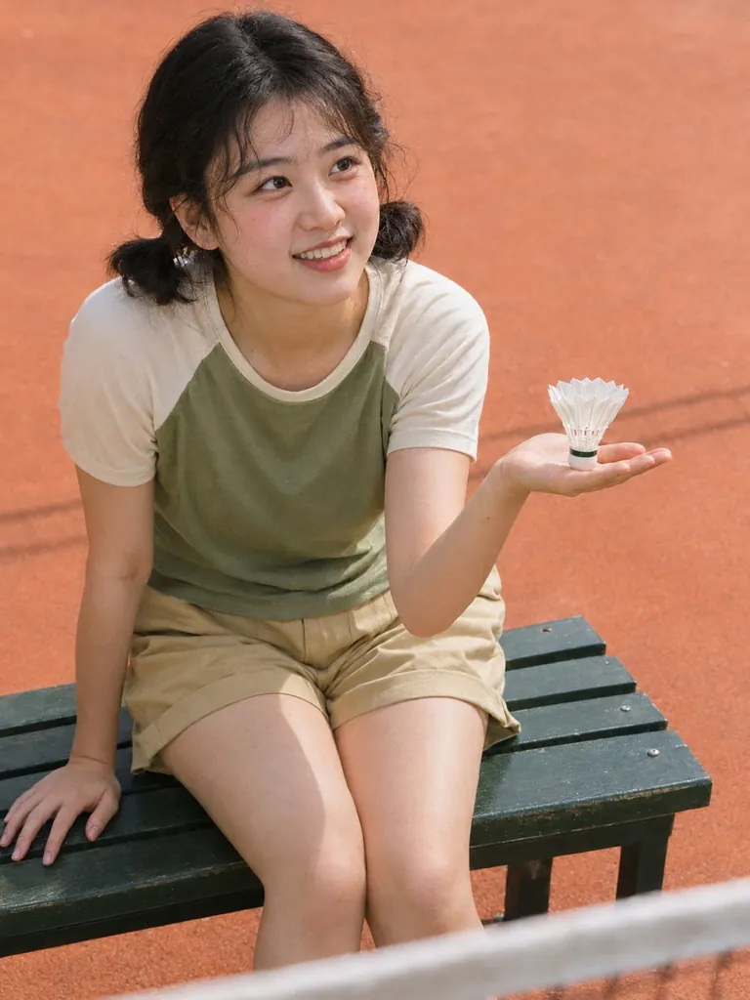

# Morning Badminton Court Snapshot — by @StarStoryX

[← Back to Community Examples](../../EXAMPLES.md) · Category: Photography · Model: `Unknown`

<a href="https://x.com/StarStoryX/status/2125200598572130416"></a>

Source: **[@StarStoryX on X](https://x.com/StarStoryX/status/2125200598572130416)** · Creator: [星光物语](https://x.com/StarStoryX)

## Prompt

```text
生成一张原生 3:4 竖幅的清晨生活写真，拍下社区球场休息时的一个瞬间。唯一人物是一位虚构的 19 岁成年东亚女性。她脸颊饱满，短圆脸带小圆下巴，浓而平直的短眉，清亮的圆眼外眼角微垂，鼻梁短、鼻翼稍宽，唇角在浅笑时一点点上扬，玫瑰棕下唇圆润。乌黑卷发扎成左右两束贴颈的短小低马尾，几绺小卷留在额侧，薄珊瑚妆带自然运动后的微红，保留鼻脸的肤纹。

她坐在清晨户外羽毛球场的深绿长凳上，身体略向前。一枚刚捡回的白羽毛球静静竖在她摊开的近侧手掌上，球托朝下，羽裙轮廓整齐，离脸和衣料都有空隙。另一只手落在身旁凳面，手指自然展开。她把目光从手心抬到球网另一边的朋友，笑眼里有一点等对方发球的着急。背景只有低处掠过的网影及干净的哑橘塑胶地。

穿罗勒绿薄棉弹力插肩运动衫，浅圆领，奶白短插肩袖在上臂中段收边，衣摆轻叠在高腰的麦芽黄防皱棉短裤上。短裤宽腿，裤口自然翻折。颈前、袖下双臂以及坐姿时的膝上腿部清楚可见。早晨清亮的白羽是脸之后最醒目的小点，罗勒绿衣身和哑橘球场做清爽对色。

用 58mm 站在凳边略俯拍，从完整发顶到膝下，人物略偏画面左边，手心羽毛球留在右侧空区。散着的晨光从侧前方照亮眼睛、眉骨和鼻尖，另一侧由球场浅线反光补亮。远处网线虚化留低，脸后空出一整块背景。真实胶片式街拍，颜色鲜明但光不过硬。

避免年龄感模糊、油蜡肤质、五官错位、多肢多指、托球手与羽片粘合、羽毛球复制、球网压在脸上、鞋腿穿过长凳、透光衣料、可读字、标签、水印和拼图。
```

## Try it

Paste the prompt into **[vinano.ai](https://vinano.ai?utm_source=github&utm_medium=readme&utm_campaign=awesome-image-video-prompts-updating&utm_content=x-page-try)** to generate your own version.

> The image and prompt belong to @StarStoryX ([original post](https://x.com/StarStoryX/status/2125200598572130416)) and are shown here with credit for reference. Creators can ask for changes or removal by opening an issue.
