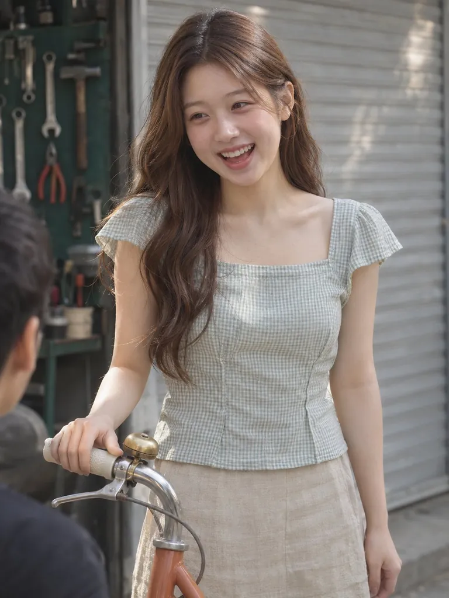

# Testing a Bicycle Bell on the Street — by @StarStoryX

[← Back to Community Examples](../../EXAMPLES.md) · Category: Photography · Model: `Unknown`

<a href="https://x.com/StarStoryX/status/2125143310587081208"></a>

Source: **[@StarStoryX on X](https://x.com/StarStoryX/status/2125143310587081208)** · Creator: [星光物语](https://x.com/StarStoryX)

## Prompt

```text
生成一张原生 3:4 竖幅的日常抓拍。午后社区自行车修理摊，一位虚构的 20 岁成年东亚女性在试一只刚换好的老式铜车铃。她是鹅蛋形短圆脸，苹果肌浅浅鼓起，浅栗细弧眉，圆而清亮的深棕眼在笑时略眯，短直鼻梁接圆鼻尖，蜜桃色饱满唇的下唇更圆。蜂蜜栗色长发松松地铺在肩后，中分，一侧别耳，发尾是自然的大卷。奶杏薄妆，颊侧保留自然肤纹。

她站在一辆砖橘色通勤自行车旁，一手松握奶白车把的近侧胶套，拇指已经让开小铜铃的拨片，另一手在身侧垂着。试响过后她立刻抬脸，对着蹲在对面修车的人笑起来，嘴唇轻张，像在说这下整条街都听得见。车把走在画面下角，铜铃是拇指外侧一枚完整的拱圆件，车架的砖橘色从下方露出一小段。

穿海盐青细格纹薄棉上衣，方领、短盖袖，后背有省线，衣摆落在米白直筒亚麻裙的高腰上。方领内的锁骨和两侧盖袖以下的手臂清楚可见。风把近侧盖袖吹得轻轻拱起，细格纹在软褶间仍然自然，砖橘车架是冷青与米白之外的一小块暖色。

用 55mm，从车把前方偏正面、比站姿眼线高一小截的位置拍，取完整发顶至腰下，双眼、握把手和铜铃清楚，车架只交代用途。背景是低对比的淡灰卷闸门和旁边一列模糊的深绿工具板。街对面的浅墙把午后光柔柔反给她，脸颊、眼皮和鼻尖有自然的亮度梯度。抓拍的感觉来自按过铃后那一下忍不住的笑。

避免年龄感模糊、五官错位、过度磨皮、多手多指、手与车把黏合、铜铃变形或复制、工具纹理叠到脸上、衣料透光、商标、文字、水印和拼图。
```

## Try it

Paste the prompt into **[vinano.ai](https://vinano.ai?utm_source=github&utm_medium=readme&utm_campaign=awesome-image-video-prompts-updating&utm_content=x-page-try)** to generate your own version.

> The image and prompt belong to @StarStoryX ([original post](https://x.com/StarStoryX/status/2125143310587081208)) and are shown here with credit for reference. Creators can ask for changes or removal by opening an issue.
