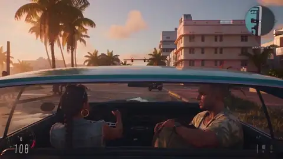

# Open-World Getaway Drive Gameplay — by @harboriis

[← Back to Community Examples](../../EXAMPLES.md) · Category: Video · Model: `Seedance 2.5`

<a href="https://x.com/harboriis/status/2125144866783105509"></a>

**[▶ Watch the full video on X](https://x.com/harboriis/status/2125144866783105509)** — the preview above is a short silent clip.

Source: **[@harboriis on X](https://x.com/harboriis/status/2125144866783105509)** · Creator: [Harboris](https://x.com/harboriis)

## Prompt

```text
Photorealistic next-gen open-world crime game gameplay, 30 seconds, recorded from a console. 16:9, 60fps, slight capture compression, natural motion blur, subtle film grain, soft bloom on bright lights. Third-person over-the-shoulder driving camera with light handheld sway. Game-style HUD, generic and unbranded.

Setting: A fictional sun-bleached subtropical coastal city. Art Deco hotels, pastel stucco, neon-lit strip malls, palm boulevards, a busy marina with yachts, humid air, a long bridge over the bay. Golden hour fading to neon dusk. Dense ambient life: joggers, tourists, scooters, street vendors, seagulls, distant helicopters.

Characters (original):

• Driver, "Marisol": woman in her late 20s, tanned, dark braided ponytail, cropped denim jacket, gold hoop earrings, aviators pushed up on her head.
• Passenger, "Dex": man in his early 30s, buzzed hair, faded floral shirt, a duffel bag on his lap, sweating nervously.
• Vehicle: sun-faded teal two-door muscle coupe with a dented fender and a cracked dashboard.

Shot-by-shot

1. 0:00-0:04, Idle. Low rear camera behind the coupe at a red light. Heat shimmer, pedestrians crossing, a scooter buzzing past, palm shadows stretching across the road. Cabin view: Marisol taps the wheel to the radio.
   ◦ Dex: "Light's green, light's green, go, go!"
   ◦ Marisol: "Relax. Nobody's watching."
2. 0:04-0:08, Launch. She floors it. Rear tires smoke, the camera snaps back with the acceleration, and a plastic bag and palm fronds whip past. A cruiser exits an alley, lights flashing red and blue across pastel storefronts. HUD: one wanted star flashes.
   ◦ Dex: "Nobody's watching, huh?"
3. 0:08-0:12, Weave. Chase camera pulls up and back. The coupe slides between a delivery van and a taxi and clips a trash can that scatters across the road. Pedestrians dive aside, with suspension bounce and mirror reflections. Two stars.
   ◦ Marisol: "Hold the bag!"
4. 0:12-0:16, Drift. Handbrake turn around a corner, tire smoke glowing orange in the sunset, sparks from the undercarriage, a short camera shake. A second cruiser joins from the side street.
   ◦ Radio (police): "All units, teal coupe, heading for the bay bridge."
5. 0:16-0:20, Neon dusk. The car runs through a sprinkler spray and neon signs flicker on in pink and cyan, reflected on the wet asphalt. Water beads on the lens. Three stars. Dex rolls down the window and laughs nervously.
   ◦ Dex: "I can't believe this is working!"
6. 0:20-0:25, Bridge. The camera rises to a cinematic wide angle as the coupe hits the bridge. Skyline glowing, bay glittering, cruiser lights trailing, a helicopter spotlight sweeping the road, sun touching the horizon with lens bloom and volumetric haze.
   ◦ Marisol (calm): "It's not working yet."
7. 0:25-0:30, Finish. Street level again. She brakes hard and skids to a stop outside a beachside motel with a flickering generic "VACANCY" sign, sand puffing around the tires. Engine ticks, sirens close in, and the HUD pulses red.
   ◦ Dex: "...Now what?"
   ◦ Marisol: "Now we run."
   ◦ Cut to black.

Music and audio

• Radio: original synth-wave with a driving bassline, 100-110 BPM, slightly muffled like a car speaker. It fades low during dialogue and opens up when the camera goes wide on the bridge.
• Sound design: rumbling V8 exhaust, tire squeal and skid, sirens rising from distant to close, helicopter rotor thump, crowd shouts, seagulls, ocean wind on the bridge, engine ticking at the end.
• Dialogue: natural, slightly overlapping, with a faint vocal reverb inside the car.

HUD (generic): minimap top right with a flashing red police radius, three wanted stars below it, a speedometer bottom left, and a subtitle line at the bottom center that mirrors the spoken dialogue.

Lighting: warm golden hour at the start, magenta and cyan neon by the end. Soft volumetric haze, accurate reflections on car paint and wet roads, shadows that lengthen as the sun drops.

Negative prompt: cartoon, anime, low-poly, cutscene look, real brand names or logos, watermark, morphing faces, extra wheels, warped text, floating objects, jittery hands, unnatural physics, oversaturated colors, black bars.
```

## Try it

Paste the prompt into **[vinano.ai](https://vinano.ai?utm_source=github&utm_medium=readme&utm_campaign=awesome-image-video-prompts-updating&utm_content=x-page-try)** to generate your own version.

> The video and prompt belong to @harboriis ([original post](https://x.com/harboriis/status/2125144866783105509)) and are shown here with credit for reference. Creators can ask for changes or removal by opening an issue.
