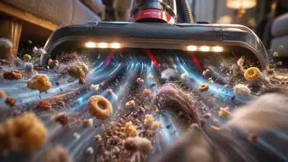

# Gorilla and Anteaters Vacuum Cleanup Comedy — by @meng_dagg695

[← Back to Community Examples](../../EXAMPLES.md) · Category: Video · Model: `Seedance 2.5`

<a href="https://x.com/meng_dagg695/status/2125229436937363834"></a>

**[▶ Watch the full video on X](https://x.com/meng_dagg695/status/2125229436937363834)** — the preview above is a short silent clip.

Source: **[@meng_dagg695 on X](https://x.com/meng_dagg695/status/2125229436937363834)** · Creator: [Shahid Wani](https://x.com/meng_dagg695)

## Prompt

```text
THE GREAT VACUUM CLEANUP
Duration: 25 seconds
Aspect Ratio: 16:9
Style: High-end Pixar-inspired 3D animated comedy, cinematic commercial quality, ultra-detailed fur, expressive characters, realistic environmental physics.
CHARACTER CONSISTENCY
Big G: A gigantic, friendly, muscular silverback gorilla with dark charcoal fur, a broad chest, expressive eyes, and a small red utility vest. Strong but goofy personality.

Fluffy Anteater Team: Three adorable, fluffy anteaters with oversized bushy tails, elongated snouts, tiny paws, and expressive eyes. Each wears a tiny colorful cleaning backpack connected to a miniature vacuum hose.
SCENE 1 — THE SUCTION PORTAL (0–4 SEC)
Extreme macro cinematic shot of a vacuum cleaner nozzle sucking up dust, cereal pieces, cookie crumbs, and floating pet hair from a living room carpet.

The camera suddenly accelerates forward, following the debris directly into the vacuum nozzle. It travels through a dark, twisting suction tunnel filled with swirling particles, creating an exhilarating first-person journey.
A bright opening appears ahead.

SCENE 2 — THE HIDDEN WORLD (4–8 SEC)

The camera bursts into an enormous, fantastical world hidden inside the vacuum cleaner.

Reveal a gigantic dusty landscape filled with mountains of crumbs, enormous cereal pieces, tangled pet hair, and floating dust clouds.
Three fluffy anteaters are struggling to clean the enormous mess with their miniature vacuum backpacks.

Suddenly, Big G, a massive silverback gorilla, enters the frame carrying an oversized industrial suction hose.

He gives the anteaters a confident thumbs-up.

SCENE 3 — THE CLEANING MISSION (8–17 SEC)

Fast-paced cinematic action montage.

The fluffy anteaters activate their suction backpacks, using their long snouts to vacuum up tiny dust particles and crumbs.
Big G swings his enormous vacuum hose across the landscape, sucking up gigantic cereal chunks and tangled pet hair.

One anteater gets dragged forward by the suction force, spinning comically before another anteater grabs its tail and saves it.

Big G proudly sucks up an entire mountain of dust in one powerful burst.

Dynamic tracking shots, dramatic low angles, energetic camera movement, exaggerated cartoon physics, flying debris, and perfectly timed comedy.

SCENE 4 — THE WARNING (17–21 SEC)

The cleaning mission appears successful.

The camera slowly pushes toward the vacuum's enormous dust bag, now swelling dangerously with collected debris.
Big G notices the bag expanding. His confident smile disappears.

One fluffy anteater points toward the bag with a terrified expression.

A tiny red warning light flashes.

The dust bag begins shaking violently.

SCENE 5 — THE EXPLOSION (21–25 SEC)

BOOOOOOM!

The dust bag explodes in an enormous cloud of dust, cereal, crumbs, and pet hair.
Big G and all three anteaters are completely covered in dust.

A brief silence.

Big G slowly blinks, looks at the camera, and sneezes.

A gigantic cloud of dust bursts from his nose, sending the anteaters flying backward.

End on a hilarious freeze-frame of their shocked, dust-covered faces.

VISUAL AND AUDIO DIRECTION

High-quality cinematic 3D animation with detailed fluffy fur.

Expressive facial animation and exaggerated body language.
Realistic volumetric dust, particle simulations, and suction physics.
Smooth transitions and continuous camera movement.
Energetic orchestral comedy soundtrack.
Layered vacuum suction sounds, whooshes, character reactions, warning beeps, and an exaggerated explosion sound.
Strong comedic sound-effect timing.
Maintain identical character appearance, clothing, proportions, and colors throughout all scenes.
IMPORTANT: No character redesigns, no sudden location changes, no additional characters, no subtitles, no random text, and no scene interruptions. The ending must be visually funny and perfectly timed.
```

## Try it

Paste the prompt into **[vinano.ai](https://vinano.ai?utm_source=github&utm_medium=readme&utm_campaign=awesome-image-video-prompts-updating&utm_content=x-page-try)** to generate your own version.

> The video and prompt belong to @meng_dagg695 ([original post](https://x.com/meng_dagg695/status/2125229436937363834)) and are shown here with credit for reference. Creators can ask for changes or removal by opening an issue.
