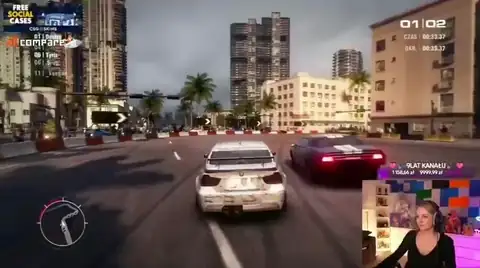

# Driving Sim Livestream Gone Wrong — by @aiwithaayat

[← Back to Community Examples](../../EXAMPLES.md) · Category: Video · Model: `Seedance 2.0`

<a href="https://x.com/aiwithaayat/status/2125102092973179367"></a>

**[▶ Watch the full video on X](https://x.com/aiwithaayat/status/2125102092973179367)** — the preview above is a short silent clip.

Source: **[@aiwithaayat on X](https://x.com/aiwithaayat/status/2125102092973179367)** · Creator: [Ayat](https://x.com/aiwithaayat)

## Prompt

```text
Create a 30-second ultra-realistic PC gaming livestream video featuring a high-quality open-world car driving simulator game. The entire video must look like a real PC gaming screen recording in 16:9 landscape aspect ratio, with gameplay occupying approximately 85–90% of the full screen and a small rectangular facecam overlay fixed on the right side showing two young adult women sitting together in a gaming setup, playing the game and reacting naturally. The gameplay must remain the main focus at all times. Start with a beautiful modern sports car parked on a wide city street, using a third-person camera positioned behind the vehicle, showing realistic buildings, roads, traffic lights, pedestrians and other vehicles. The female game character starts driving and accelerates through the city streets, with realistic steering, smooth vehicle physics, moving traffic, road markings and detailed city environments. The car makes a sharp turn at an intersection, begins drifting slightly and almost loses control, with realistic tire movement, road friction and camera motion. Continue the gameplay without interruption while both girls remain visible in the small facecam overlay on the right, reacting excitedly, with one girl looking surprised and the other laughing while watching the screen. The sports car then enters a busy outdoor shopping market street featuring colorful shops, fruit and vegetable stalls, market decorations, pedestrians and narrow roads. The driver struggles to control the speeding car, suddenly loses control and crashes into a fruit and vegetable market stall. Fruits, vegetables and lightweight market objects scatter realistically, and the car stops near the stall. In the facecam overlay, both girls react with shocked and funny expressions, laughing at the unexpected crash. End with a cinematic gaming crash moment. Use realistic high-end open-world driving game graphics, consistent sports car, driver and environment throughout, smooth continuous gameplay camera, realistic vehicle physics and collision effects, natural facial expressions and reactions, detailed textures, realistic lighting and shadows. No real-world camera shots outside the gaming screen, no unnecessary transitions or unrelated scenes, no distorted vehicles, faces, hands or objects, no random UI changes, no flickering and no visual glitches. The final result must look like an authentic PC gaming livestream recording, not a cinematic movie about people playing a game. The gameplay must always remain full-screen and clearly visible, with the two girls appearing only inside the small facecam overlay on the right side.
```

## Try it

Paste the prompt into **[vinano.ai](https://vinano.ai?utm_source=github&utm_medium=readme&utm_campaign=awesome-image-video-prompts-updating&utm_content=x-page-try)** to generate your own version.

> The video and prompt belong to @aiwithaayat ([original post](https://x.com/aiwithaayat/status/2125102092973179367)) and are shown here with credit for reference. Creators can ask for changes or removal by opening an issue.
