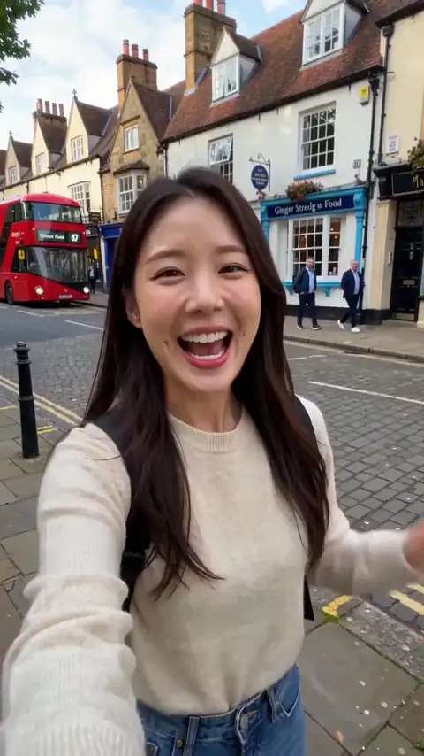

# English Village Travel Vlog — by @Lianaalane

[← Back to Community Examples](../../EXAMPLES.md) · Category: Video · Model: `Seedance 2.0`

<a href="https://x.com/Lianaalane/status/2125089432965632262"></a>

**[▶ Watch the full video on X](https://x.com/Lianaalane/status/2125089432965632262)** — the preview above is a short silent clip.

Source: **[@Lianaalane on X](https://x.com/Lianaalane/status/2125089432965632262)** · Creator: [liana](https://x.com/Lianaalane)

## Prompt

```text
Create a 30-second ultra-realistic cinematic travel vlog featuring a beautiful young East Asian woman with long, straight dark brown hair, wearing a cream knitted sweater, blue jeans, white sneakers, and a black backpack.

Scene 1 (0–5 seconds):
She walks through a charming English village street, holding the camera in selfie mode. Beautiful historic white cottages, traditional shops, pedestrians, and a classic red double-decker bus are visible in the background. She smiles and enthusiastically introduces the location.

Scene 2 (5–9 seconds):
She explores a peaceful tree-lined walking path, turning toward the camera with a natural smile. Show lush green trees, soft daylight, and beautiful countryside atmosphere.

Scene 3 (9–15 seconds):
She discovers a traditional outdoor British street food stall decorated with warm hanging lights. She interacts with the friendly male vendor, receives a freshly prepared golden crispy snack, takes a bite, and reacts happily.

Scene 4 (15–20 seconds):
Show her enjoying the food in a close-up selfie shot, followed by a breathtaking panoramic view of a picturesque English village surrounded by rolling green hills.

Scene 5 (20–25 seconds):
Light rain begins falling. She opens a transparent umbrella, smiles at the camera, and walks along a beautiful wet village street reflecting warm lights.

Scene 6 (25–30 seconds):
She arrives at a cozy English countryside home, opens the front door, walks inside, and finishes the vlog with a cheerful selfie shot in a warmly lit living room.

Visual Style:
Ultra-photorealistic 4K video, natural human facial expressions, realistic skin texture, authentic handheld selfie-camera movement, smooth cinematic transitions, beautiful natural lighting, realistic rain physics, detailed environments, natural body movements, consistent character appearance, authentic travel-vlogger energy.

Important Instructions:
Maintain exactly the same woman's face, hairstyle, clothing, and backpack throughout all scenes. No face changes, no distorted hands, no extra fingers, no duplicate people, no unnatural movements, no flickering, and no random scene changes. Keep the video visually consistent and realistic.
```

## Try it

Paste the prompt into **[vinano.ai](https://vinano.ai?utm_source=github&utm_medium=readme&utm_campaign=awesome-image-video-prompts-updating&utm_content=x-page-try)** to generate your own version.

> The video and prompt belong to @Lianaalane ([original post](https://x.com/Lianaalane/status/2125089432965632262)) and are shown here with credit for reference. Creators can ask for changes or removal by opening an issue.
