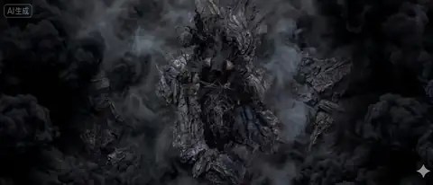

# Giant Golden Eagle Through Storm Clouds — by @draavenai

[← Back to Community Examples](../../EXAMPLES.md) · Category: Video · Model: `Seedance 2.0`

<a href="https://x.com/draavenai/status/2125228862774669606"></a>

**[▶ Watch the full video on X](https://x.com/draavenai/status/2125228862774669606)** — the preview above is a short silent clip.

Source: **[@draavenai on X](https://x.com/draavenai/status/2125228862774669606)** · Creator: [Draaven](https://x.com/draavenai)

## Prompt

```text
A breathtaking cinematic fantasy scene featuring a gigantic majestic golden eagle flying through a mysterious sky filled with massive dark storm clouds. The eagle has enormous powerful wings, beautifully detailed golden-brown feathers, sharp eyes, and an impressive wingspan. As it emerges from the dark clouds, warm golden sunlight illuminates its feathers. The camera follows the eagle from behind as it spreads its wings and glides gracefully above a vast green landscape. Lightning flashes in the distant clouds, creating a dramatic atmosphere. Spectacular aerial shots, realistic feather movements, volumetric clouds, cinematic lighting, smooth camera tracking, photorealistic CGI, epic fantasy atmosphere, 4K movie quality.
```

## Try it

Paste the prompt into **[vinano.ai](https://vinano.ai?utm_source=github&utm_medium=readme&utm_campaign=awesome-image-video-prompts-updating&utm_content=x-page-try)** to generate your own version.

> The video and prompt belong to @draavenai ([original post](https://x.com/draavenai/status/2125228862774669606)) and are shown here with credit for reference. Creators can ask for changes or removal by opening an issue.
