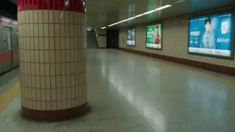

# Subway Station Fight Scene — by @ZDuo_MoreAi

[← Back to Community Examples](../../EXAMPLES.md) · Category: Video · Model: `Seedance 2.0`

<a href="https://x.com/ZDuo_MoreAi/status/2125388245756526610"></a>

**[▶ Watch the full video on X](https://x.com/ZDuo_MoreAi/status/2125388245756526610)** — the preview above is a short silent clip.

Source: **[@ZDuo_MoreAi on X](https://x.com/ZDuo_MoreAi/status/2125388245756526610)** · Creator: [ZDuo.MoreAi](https://x.com/ZDuo_MoreAi)

## Prompt

```text
A dynamic, cinematic action scene set inside a underground subway station. A young East Asian woman with long black hair, wearing a white tank top and blue jeans, is launched back-first into a large tiled column, causing the pillar to crack violently, sending concrete debris, dust, and rubble flying across the floor She recovers, crouching low into a combat stance with an intense look, then charges forward Fast-paced tracking camera follows her as she fights hand-to-hand against a man in a dark business suit, exchanging rapid punches and dodges. Cinematic camera motion, martial arts action, gritty lighting, photorealistic, 8k resolution, filmic quality.
```

## Try it

Paste the prompt into **[vinano.ai](https://vinano.ai?utm_source=github&utm_medium=readme&utm_campaign=awesome-image-video-prompts-updating&utm_content=x-page-try)** to generate your own version.

> The video and prompt belong to @ZDuo_MoreAi ([original post](https://x.com/ZDuo_MoreAi/status/2125388245756526610)) and are shown here with credit for reference. Creators can ask for changes or removal by opening an issue.
