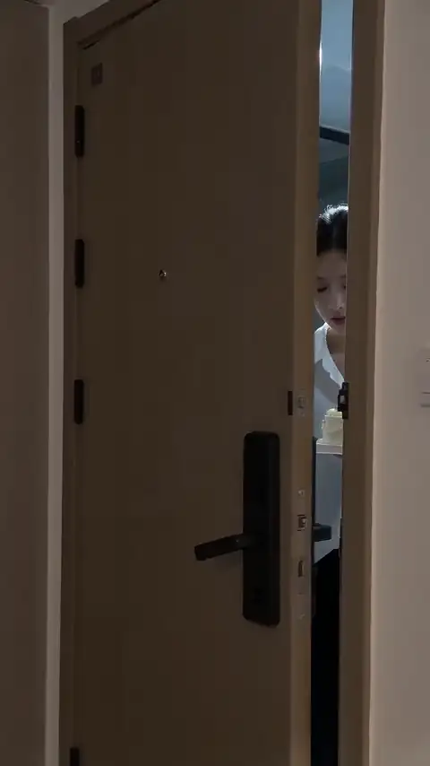

# Birthday Night Working Overtime — by @Adam38363368936

[← Back to Community Examples](../../EXAMPLES.md) · Category: Video · Model: `Seedance 2.0`

<a href="https://x.com/Adam38363368936/status/2125242014468075906"></a>

**[▶ Watch the full video on X](https://x.com/Adam38363368936/status/2125242014468075906)** — the preview above is a short silent clip.

Source: **[@Adam38363368936 on X](https://x.com/Adam38363368936/status/2125242014468075906)** · Creator: [Adam也叫吉米](https://x.com/Adam38363368936)

## Prompt

```text
正向提示词：竖屏9:16，15秒写实纪实短片，东亚年轻漂亮女生，自然素颜真实肤质，深夜独居出租屋，暖黄昏暗室内灯光，窗外城市万家灯火，疲惫下班拎着精致小生日蛋糕回家，进门带着微弱期待感，拿起手机看到加班弹窗消息，表情瞬间从温柔期待变为落寞疲惫，笑容瞬间消失，眼神空洞无奈，情绪极致反差，桌上孤零零的生日蛋糕和刺眼发光的电脑屏幕形成冷暖强烈对比，镜头特写脸部微表情，轻微真实手持抖动，低饱和电影纪实质感，细腻治愈致郁氛围感，真实打工人生活，画面干净高级，细节拉满，无刻意表演，生活化真实情绪
负面提示词：欢快，大笑，热闹，派对，多人，喜庆，高饱和色彩，阳光白天，礼物鲜花，夸张演技，过度磨皮美颜，卡通，动漫，二次元，特效，贴纸，水印，logo，文字遮挡，畸形脸，肢体穿模，虚假光影，明亮画面，正能量，惊喜反转，搞笑
字幕：原来长大的生日，是独自加班的夜晚
15秒卡点BGM：前奏温柔舒缓，5秒处轻微鼓点低落转折，结尾静音留白（伤感治愈纯音乐）
变速参数：0-3秒1.0倍，3-7秒0.9倍（看到消息慢动作反转），7-15秒1.0倍
```

## Try it

Paste the prompt into **[vinano.ai](https://vinano.ai?utm_source=github&utm_medium=readme&utm_campaign=awesome-image-video-prompts-updating&utm_content=x-page-try)** to generate your own version.

> The video and prompt belong to @Adam38363368936 ([original post](https://x.com/Adam38363368936/status/2125242014468075906)) and are shown here with credit for reference. Creators can ask for changes or removal by opening an issue.
