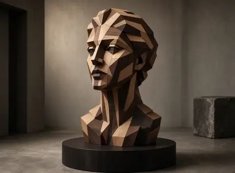

# Cubist Wood Sculptures Collection — by @msksmiss

[← Back to Community Examples](../../EXAMPLES.md) · Category: Video · Model: `Grok Imagine`

<a href="https://x.com/msksmiss/status/2125380493004988749"></a>

**[▶ Watch the full video on X](https://x.com/msksmiss/status/2125380493004988749)** — the preview above is a short silent clip.

Source: **[@msksmiss on X](https://x.com/msksmiss/status/2125380493004988749)** · Creator: [MsMsk](https://x.com/msksmiss)

## Prompt

```text
Collection of surreal abstract cubism sculptures, full view of beautiful women constructed with laminated pieces of oak and ebony wood, beautifully assembled, 4:3 AR
```

## Try it

Paste the prompt into **[vinano.ai](https://vinano.ai?utm_source=github&utm_medium=readme&utm_campaign=awesome-image-video-prompts-updating&utm_content=x-page-try)** to generate your own version.

> The video and prompt belong to @msksmiss ([original post](https://x.com/msksmiss/status/2125380493004988749)) and are shown here with credit for reference. Creators can ask for changes or removal by opening an issue.
