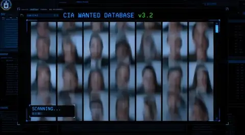

# Spy Movie Computer Face Scan — by @Gundys69

[← Back to Community Examples](../../EXAMPLES.md) · Category: Video · Model: `Grok Imagine`

<a href="https://x.com/Gundys69/status/2125352434570567771"></a>

**[▶ Watch the full video on X](https://x.com/Gundys69/status/2125352434570567771)** — the preview above is a short silent clip.

Source: **[@Gundys69 on X](https://x.com/Gundys69/status/2125352434570567771)** · Creator: [Bob ®️](https://x.com/Gundys69)

## Prompt

```text
A video clip that looks like the screen of a CIA computer that is quickly scanning through wanted faces and then it stops on one and maps start emerging trying to locate the subject in a city. Like you would see in a spy movie
```

## Try it

Paste the prompt into **[vinano.ai](https://vinano.ai?utm_source=github&utm_medium=readme&utm_campaign=awesome-image-video-prompts-updating&utm_content=x-page-try)** to generate your own version.

> The video and prompt belong to @Gundys69 ([original post](https://x.com/Gundys69/status/2125352434570567771)) and are shown here with credit for reference. Creators can ask for changes or removal by opening an issue.
