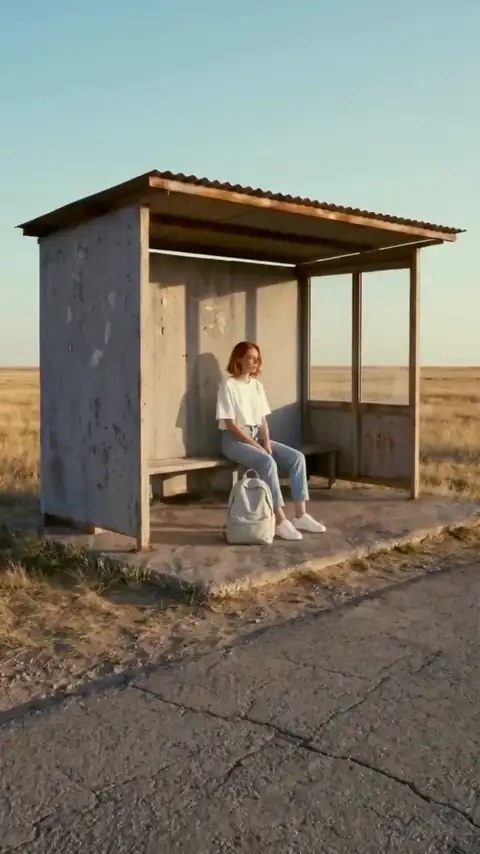

# Waiting at a Country Bus Stop — by @Zoyavelle

[← Back to Community Examples](../../EXAMPLES.md) · Category: Video · Model: `Wan 3.0`

<a href="https://x.com/Zoyavelle/status/2124730552133763350"></a>

**[▶ Watch the full video on X](https://x.com/Zoyavelle/status/2124730552133763350)** — the preview above is a short silent clip.

Source: **[@Zoyavelle on X](https://x.com/Zoyavelle/status/2124730552133763350)** · Creator: [Zoya](https://x.com/Zoyavelle)

## Prompt

```text
A cinematic, ultra-realistic 20-second vertical video of a young woman with short auburn hair wearing a white oversized T-shirt, light blue jeans, white sneakers, and a light blue backpack, sitting alone at an old rural bus stop in the middle of an empty countryside road. Golden hour sunlight casts long shadows across the cracked asphalt, with dry grass fields stretching into the distance. Start with a wide establishing shot of the lonely bus shelter, then slowly move closer to the woman sitting quietly on the bench. Cut to a cinematic close-up of her face as she looks over her shoulder toward the road. She stands up, adjusts her backpack, and begins walking along the deserted road. A vintage yellow school bus approaches from the distance with its headlights glowing warmly. Capture her walking toward the bus from behind, followed by a dramatic high-angle aerial shot showing the woman and the yellow bus on the empty country road surrounded by golden fields. Photorealistic textures, natural human movement, warm cinematic lighting, realistic shadows, subtle film grain, smooth camera transitions, shallow depth of field, emotional storytelling, 4K quality, 9:16 aspect ratio.
```

## Try it

Paste the prompt into **[vinano.ai](https://vinano.ai?utm_source=github&utm_medium=readme&utm_campaign=awesome-image-video-prompts-updating&utm_content=x-page-try)** to generate your own version.

> The video and prompt belong to @Zoyavelle ([original post](https://x.com/Zoyavelle/status/2124730552133763350)) and are shown here with credit for reference. Creators can ask for changes or removal by opening an issue.
