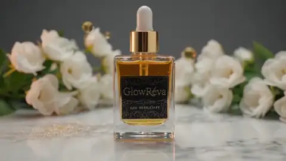

# Golden Serum Skincare Commercial — by @AIwithRubii

[← Back to Community Examples](../../EXAMPLES.md) · Category: Video · Model: `MiniMax H3`

<a href="https://x.com/AIwithRubii/status/2125273931812925647"></a>

**[▶ Watch the full video on X](https://x.com/AIwithRubii/status/2125273931812925647)** — the preview above is a short silent clip.

Source: **[@AIwithRubii on X](https://x.com/AIwithRubii/status/2125273931812925647)** · Creator: [Rubi](https://x.com/AIwithRubii)

## Prompt

```text
Create a luxurious cinematic skincare commercial featuring a premium golden facial serum bottle. Begin with an elegant macro product reveal surrounded by delicate white flowers and floating golden particles. Transition into close-up shots of the golden dropper releasing a glowing serum droplet. Show a beautiful woman applying the serum to her face in a sophisticated luxury bathroom. Capture natural skin texture, soft expressions, and elegant movements. Finish with a dramatic hero shot of the serum bottle against a deep black and warm golden background. Ultra-realistic, premium beauty advertising, cinematic lighting, smooth camera movements, macro details, 4K, vertical 9:16. Maintain exact product packaging and label consistency throughout.
```

## Try it

Paste the prompt into **[vinano.ai](https://vinano.ai?utm_source=github&utm_medium=readme&utm_campaign=awesome-image-video-prompts-updating&utm_content=x-page-try)** to generate your own version.

> The video and prompt belong to @AIwithRubii ([original post](https://x.com/AIwithRubii/status/2125273931812925647)) and are shown here with credit for reference. Creators can ask for changes or removal by opening an issue.
