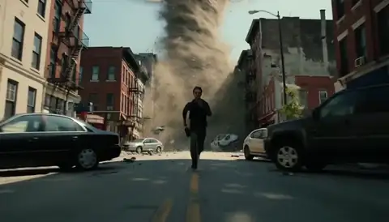

# Tornado Debris Spells SURVIVE — by @CharaspowerAI

[← Back to Community Examples](../../EXAMPLES.md) · Category: Video · Model: `MiniMax H3`

<a href="https://x.com/CharaspowerAI/status/2124835432126927006"></a>

**[▶ Watch the full video on X](https://x.com/CharaspowerAI/status/2124835432126927006)** — the preview above is a short silent clip.

Source: **[@CharaspowerAI on X](https://x.com/CharaspowerAI/status/2124835432126927006)** · Creator: [Pierrick Chevallier | IA](https://x.com/CharaspowerAI)

## Prompt

```text
High-speed chase shot through an abandoned post-apocalyptic city in daylight. The camera races backward ahead of a lone runner while a gigantic dust tornado destroys the avenue behind them. Cars roll through the air, windows explode and debris fills the sky. The tornado suddenly tears an entire building facade apart. Thousands of concrete, steel and glass fragments are sucked upward, rotating violently inside the vortex. From above, the debris unexpectedly aligns into enormous floating letters spelling “SURVIVE.” The runner passes underneath as the tornado instantly destroys the word again. Massive disaster-movie VFX, intense speed, photorealistic debris and atmospheric destruction.
```

## Try it

Paste the prompt into **[vinano.ai](https://vinano.ai?utm_source=github&utm_medium=readme&utm_campaign=awesome-image-video-prompts-updating&utm_content=x-page-try)** to generate your own version.

> The video and prompt belong to @CharaspowerAI ([original post](https://x.com/CharaspowerAI/status/2124835432126927006)) and are shown here with credit for reference. Creators can ask for changes or removal by opening an issue.
