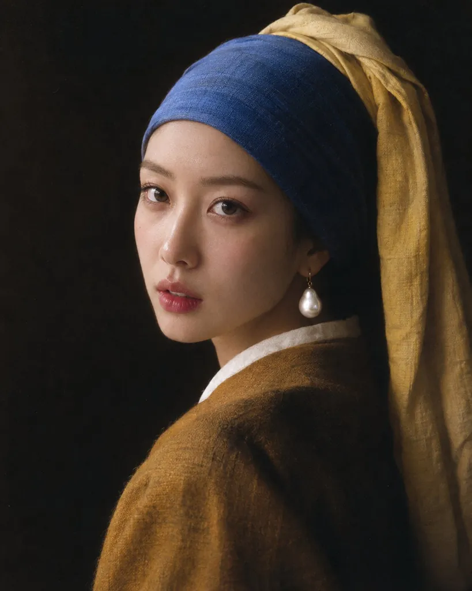

# Pearl Earring Window-Light Film Portrait — by @cheoneusin

[← Back to Community Examples](../../EXAMPLES.md) · Category: Photography · Model: `GPT Image 2.6`

<a href="https://x.com/cheoneusin/status/2125369304082485724"></a>

Source: **[@cheoneusin on X](https://x.com/cheoneusin/status/2125369304082485724)** · Creator: [천유신](https://x.com/cheoneusin)

## Prompt

```text
A present-day window-light portrait in a dark Paris interior shot on Kodak Portra 400 35mm film of a woman glancing back over her left shoulder in a blue-and-yellow headwrap and one large pearl earring, recreating the famous Vermeer painting of a girl with a pearl earring.

This image is one single photograph with one pose only. It is never a collage, a photo strip, a grid, split panels, a border or more than one frame.

## Hair and makeup
Fichu en lin — An ultramarine linen headwrap wound smoothly around her head and hiding all her hair, with a long band of pale ochre-yellow cloth falling from the top down behind her back.
Teint nu — A bare-looking base with almost no coverage and natural color left on the cheeks, the skin soft and luminous in the window light.
Rougeur naturelle — A barely-there pink tint on the cheeks melts into the base with no powder edge.
Bouche mordue — A soft rosy-red lip color pressed into the center of the lips and fading outward, with a small wet highlight on the lower lip.

## Expression
Regard par-dessus l'épaule — Her eyes turn fully back into the lens, wide, clear and calm, the brows relaxed.
Lèvres entrouvertes — Her lips part slightly as if she were about to say something, a quiet held breath rather than a smile.

## Outfit
Ochre jacket — A coarse ochre-brown wool jacket with a plain white collar edge showing at the neck, its folds deep in shadow.

## Props and nails
Pearl drop earring — A single large teardrop pearl hangs from her left earlobe, catching one bright white highlight from the window and a soft reflection of the white collar below.

## Pose
Over-the-shoulder turn — Her body faces frame left in near profile with her shoulders turned away from the camera, and only her head turns back over her left shoulder toward the lens, chin slightly lifted.

## Style
Vermeer — The look of a 17th-century Dutch portrait recreated as a real photograph: one figure against darkness, still and luminous.
palette — Ultramarine, ochre yellow, warm cream skin and deep burnt-umber black, with no pastel or neon.

## Scene
Dark interior — A plain, almost black wall of deep umber behind her with nothing else visible, the edge of a tall window just out of frame on the left.
She is alone in the frame. No writing, signs, logos or labels anywhere in the image.

## Light
Fenêtre de Vermeer — A single tall window at frame left lights her face, the headwrap and the pearl with soft cool daylight, while the far side of her face and her shoulders fall into deep shadow with no fill.
창문 캐치라이트 — The window leaves a small soft highlight in the upper part of each iris.

## Optics
Portra 400 — Kodak Portra 400 35mm film: warm cream skin, creamy roll-off in the highlights and deep, soft blacks.
胶片颗粒 — Fine, even 颗粒 sits across the whole frame, slightly heavier in the 暗部.
50mm — A 50mm standard lens with shallow depth of field, so the face keeps natural proportions.

## Camera
Plan rapproché — The frame runs from the top of the headwrap to just below her shoulders, taken at her eye level, with her face in the upper center and darkness filling the rest.
Focus — Focus sits on her nearer eye and the pearl.

SUBJECT: An adult woman in her twenties. She has a very slim, skinny build with slender arms and legs and a narrow waist. Face identity comes only from the attached character reference; do not copy any real celebrity face.

No captions, no dates, no timestamps, no watermark, no stickers, no doodles, no frame borders and no overlay text anywhere in the image.
No logos, brand marks, monograms or brand lettering anywhere on clothing, props, furniture or background.

## Finish
Portrait argentique — The whole frame reads as a present-day window-light 35mm film portrait, not a painting or a studio beauty shoot.
photoréaliste — Ultra-realistic 8K photographic detail: real pores on the skin, real weave in the linen, real wear on the wool.
prise de vue réelle — A real person photographed on location, never an illustration, anime frame, 3D render or plastic-skinned CGI.
```

## Try it

Paste the prompt into **[vinano.ai](https://vinano.ai?utm_source=github&utm_medium=readme&utm_campaign=awesome-image-video-prompts-updating&utm_content=x-page-try)** to generate your own version.

> The image and prompt belong to @cheoneusin ([original post](https://x.com/cheoneusin/status/2125369304082485724)) and are shown here with credit for reference. Creators can ask for changes or removal by opening an issue.
