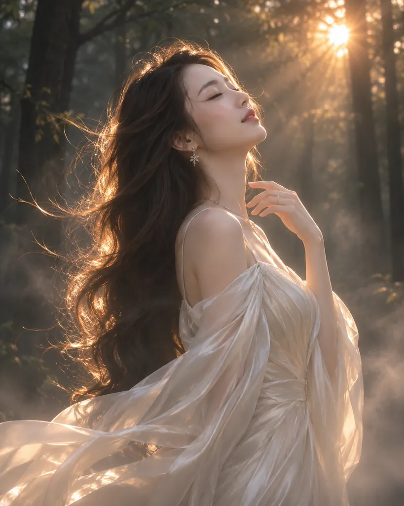

# Ethereal Misty Forest Profile Portrait — by @WanderingC76

[← Back to Community Examples](../../EXAMPLES.md) · Category: Photography · Model: `GPT Image 2.6`

<a href="https://x.com/WanderingC76/status/2125139350984036387"></a>

Source: **[@WanderingC76 on X](https://x.com/WanderingC76/status/2125139350984036387)** · Creator: [Wandering Corner](https://x.com/WanderingC76)

## Prompt

```text
A serene, ethereal portrait of a young woman standing in a misty forest at dusk or dawn, captured in profile with her head tilted slightly back and eyes closed in peaceful bliss. She has long, dark, wavy hair catching the soft backlight as it flows gently in the breeze, and one graceful hand raised near her chest and chin. She wears a flowing, draped off-white silk or satin gown that catches the warm golden sunlight filtering through the dense, shadowy trees behind her. The atmosphere is moody, dreamlike, and cinematic, with soft mist, subtle rim lighting on her hair, shoulders, and fabric, deep forest shadows, and a glowing warm sunflare in the background. --ar 4:5
```

## Try it

Paste the prompt into **[vinano.ai](https://vinano.ai?utm_source=github&utm_medium=readme&utm_campaign=awesome-image-video-prompts-updating&utm_content=x-page-try)** to generate your own version.

> The image and prompt belong to @WanderingC76 ([original post](https://x.com/WanderingC76/status/2125139350984036387)) and are shown here with credit for reference. Creators can ask for changes or removal by opening an issue.
