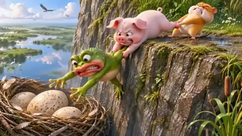

# Frog, Pig and Hamster Wetland Chase Comedy — by @Viniai_

[← Back to Community Examples](../../EXAMPLES.md) · Category: Video · Model: `Seedance 2.5`

<a href="https://x.com/Viniai_/status/2125068089830347155"></a>

**[▶ Watch the full video on X](https://x.com/Viniai_/status/2125068089830347155)** — the preview above is a short silent clip.

Source: **[@Viniai_ on X](https://x.com/Viniai_/status/2125068089830347155)** · Creator: [Vini](https://x.com/Viniai_)

## Prompt

```text
CHARACTER LOCK
Style: premium 3D animated comedy film, Pixar/Illumination quality, glossy soft-light render, rich saturated colours, sunny wetland valley with tall green reeds and brown cattails, crisp blue sky with fluffy clouds, 16:9, cinematic 24fps, dynamic but readable camera, fast slapstick timing, no text, no subtitles.
Characters (keep identical in every shot):
FROG – chubby bright-green frog, huge glossy red lips, bulging yellow eyes, dramatic over-the-top expressions.
PIG – small round pink piglet, big ears, shiny pink skin, cute curly tail.
HAMSTER – tiny orange-and-cream hamster, huge black eyes, round cheeks.
WOLF – grumpy grey wolf with thick shaggy fur, light-grey belly, pale eyes, villain scowl, eyes pop out like ping-pong balls when shocked.
HYENA – goofy spotted brown hyena with a messy hair bun on top of her head, buck-toothed grin, spiral-eyed when dizzy.
Sound (always): loud, crisp, full-range cinematic cartoon mix — punchy whooshes, boings, splats, thuds, squeaks, cartoon voices (gasps, yells, giggles, screams, no words), bright orchestral comedy score, deep clean bass, no muffled audio.

Clip 1 – Cliff & eagle (0:00–0:15)

High on a mossy cliff edge above a wide wetland valley, a twig nest with big speckled eggs. FROG clings to the rock, stretching for the eggs with greedy eyes; PIG and HAMSTER peek over the ledge behind him. A huge bald eagle dives out of the clouds straight at camera, wings spread wide, and snatches PIG in its talons; PIG grabs FROG's leg, HAMSTER clings on top — a dangling chain of three swinging through the open sky. The chain slips loose: all three plunge down the vertical cliff face, bouncing off the rock wall in fast tumbling shots, then smash into the wall in a cartoon pile — HAMSTER on PIG on FROG — and peel off, flipping downward.
Sound: eagle screech, wind rush, wing flaps, squeals and frog scream, fast rock bonks, comic slide-whistle fall.

Clip 2 – Landing on the wolf (0:12–0:30)

Top-down shot: a deep muddy crater at the cliff base; WOLF lies sprawled on his back in the mud like a snow angel. PIG lands belly-first on his stomach, HAMSTER lands on his nose, FROG flops into the grass beside him. WOLF's eyes pop out huge, jaw drops. Close-up: HAMSTER sitting on WOLF's black nose, blinking. The trio leaps off and sprints away down a muddy path through tall cattails, splashing puddles. WOLF sits up dizzy, then his face turns to a furious scowl; he pushes himself up, snarls and charges after them on all fours, low camera, mud flying — he runs straight through an old rubber tyre that gets stuck around his body.
Sound: big squishy mud splat, boing, eye-pop sound, panting squeaks, puddle splashes, angry wolf growl, rubber tyre thunk.

Clip 3 – Hyena kiss (0:30–0:48)

Tall green reeds part: HYENA peeks out with a goofy toothy grin, hair bun wobbling. She steps onto the path as PIG scurries past. WOLF charges in and slams face-first into HYENA — extreme close-up of WOLF's giant shocked eyes — their mouths smash into an accidental kiss, both frozen, eyes wide. They pull apart, side-by-side profiles, both gagging in disgust, then both puke glittering rainbow streams onto the ground, rainbow puddles spreading.
Sound: reed rustle, goofy hyena giggle, big cartoon smooch "mwah", record-scratch silence, gagging sounds, sparkly rainbow-vomit gush.

Clip 4 – Chase to the edge (0:48–1:02)

Ultra-low ground camera on a wet path between cattails: WOLF (tyre still around his waist) runs past camera, trio tiny in the distance; huge paws stomp into puddles right in front of lens. Cut to the trio reaching a cliff edge that drops to a deep blue ocean. PIG stands on the brink, FROG puffs up into a round green ball beside her, HAMSTER behind. A gust — FROG is flung into the sky spinning, flies over the reeds.
Sound: heavy footsteps, splashing puddles, wind gust, frog "boing" inflate pop, whistling flight.

Clip 5 – Wolf & hyena tumble (1:02–1:24)

PIG and HAMSTER stand at the cliff edge looking back. WOLF sneaks out of the reeds behind them, creeps closer, lunges — PIG bounces away and WOLF crashes into the dirt in a big dust cloud. FROG lands back next to PIG; the trio laughs. HYENA and WOLF tangle together in a dizzy pile; WOLF leaps through the air at the trio, misses. HYENA curls into a rolling furry ball and barrels down the path with a fiery explosion burst behind her, golden sunset light.
Sound: sneaky tiptoe music, whoosh, dust thud, giggles, cartoon crash pile, rolling rumble, big fiery boom.

Clip 6 – Pig speedboat (1:24–1:40)

The trio jumps off the cliff toward the open ocean, mid-air shot over deep blue water. PIG inflates and transforms into a glossy pink pig-shaped speedboat with a spinning rear propeller and tail fin; FROG and HAMSTER drop into the cockpit. The boat slams into the sea with a huge white splash at the base of the cliff, then rockets out and surfs up the face of a giant curling wave, launching into the air and landing in foamy spray.
Sound: jump whoosh, magical transform pop, engine rev, propeller buzz, massive ocean splash, wave roar, cheering squeaks.

Clip 7 – Leopard hovercraft chase (1:36–1:52)

Top-down shot down the cliff: WOLF and HYENA dive into the ocean. They burst out riding a leopard-print hovercraft with a big rear fan; WOLF steers, snarling, racing right behind the pink pig-boat. Wide shot: a gigantic turquoise barrel wave curls; both vehicles surf through the tube; the pink boat and the hovercraft flip sideways inside the wave, WOLF reaching out to grab FROG, close calls.
Sound: dive splash, hovercraft fan roar, engine chase music, thundering barrel wave, water spray hiss, frog screams.

Clip 8 – Whale (1:52–2:12)

White spray fills the frame, clears to calm ocean: a huge blue whale's back surfaces. The whale opens its enormous mouth from below; the pink pig-boat speeds out from inside the whale's mouth past baleen and a swirl of colourful fish; the leopard hovercraft is still inside. The pig-boat races away with friendly dolphins leaping alongside. Inside the whale's mouth: WOLF sits stunned on the tongue, hovercraft upside down on his head.
Sound: whale deep groan, water rush, fish flutter, engine zoom, dolphin clicks and chirps, echoing gulp.

Clip 9 – Spout & sunset ending (2:10–2:24)

The whale blows a giant water spout, launching WOLF and the leopard hovercraft high into the sky, both spinning and flailing among the clouds. Final shot: golden sunset over the ocean, the pink pig-boat cruises toward camera with FROG and HAMSTER cheering on board, a group of happy dolphins jumping on both sides, warm glowing light.
Sound: powerful whale blowhole whoosh, wolf scream fading away, cartoon "ding" twinkle, triumphant warm orchestral finale, dolphin chirps, soft waves.
```

## Try it

Paste the prompt into **[vinano.ai](https://vinano.ai?utm_source=github&utm_medium=readme&utm_campaign=awesome-image-video-prompts-updating&utm_content=x-page-try)** to generate your own version.

> The video and prompt belong to @Viniai_ ([original post](https://x.com/Viniai_/status/2125068089830347155)) and are shown here with credit for reference. Creators can ask for changes or removal by opening an issue.
