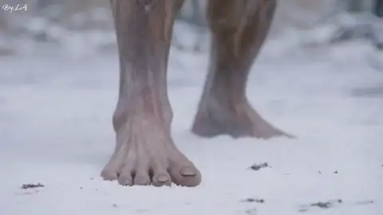

# Snowy Forest Beast Trailer — by @Viniai_

[← Back to Community Examples](../../EXAMPLES.md) · Category: Video · Model: `Seedance 2.5`

<a href="https://x.com/Viniai_/status/2125422309116879008"></a>

**[▶ Watch the full video on X](https://x.com/Viniai_/status/2125422309116879008)** — the preview above is a short silent clip.

Source: **[@Viniai_ on X](https://x.com/Viniai_/status/2125422309116879008)** · Creator: [Vini](https://x.com/Viniai_)

## Prompt

```text
Style: photorealistic dark-fantasy creature film, shot like a premium nature documentary / movie trailer, anamorphic 35mm look, shallow depth of field, soft overcast winter light, cold desaturated grey-green grade with warm skin tones, light snowfall and drifting snow particles, a misty snowy pine forest with tall straight dark trunks and snow-covered fallen logs, fast trailer-style cuts with extreme macro close-ups, 16:9, 24fps, no text, no subtitles.
Creature (keep identical in every shot): a huge hyper-muscular humanoid forest beast, 8 ft tall, shredded abs and veiny arms, wrinkled leathery pinkish-grey skin covered with dark grey mottled spots and blotches, long straight platinum-white hair falling down its back and chest. Its head carries a large flat star-shaped bony crest, like an open hand, with 5–6 thick fleshy arms radiating outward; each arm ends in a small eel/snake-like head with its own flowing white hair mane, tiny eyes and two small hanging tusks — these heads move on their own. Main face: goat/bat-like wrinkled snout, small amber eyes, long sharp yellowed fangs. Wears a torn loincloth made of dry brown leaves and bark tied at the waist with a thick rope. Bare long-toed feet, long knuckly fingers with thick yellow claws.
Sound (always): loud, crisp, full-range premium trailer sound design — deep sub-bass booms on every hard cut, heavy crunching footsteps in snow, wet creature breaths and low growls, creaking skin and muscle, hair whooshes, wind through pines, tense dark cinematic score with pulsing low strings and taiko hits building in intensity, clean deep bass, no muffled audio, no dialogue.

Clip 1 (0:00–0:09)

Fast macro reveal cuts, camera moving up the creature as it slowly walks through the snowy forest: bare wrinkled spotted feet stepping into fresh snow; muscular veiny legs and the torn leaf-and-bark loincloth swinging; low-angle shot of the shredded abs and rope belt with long white hair hanging past the arms; snarling crested face with fangs and the star crest framed by white hair; side close-up of one snake-head on the crest sniffing the air, hair blowing; extreme close-up of the mouth pulling back into a fanged grin; extreme close-up of a small amber eye opening among deep wrinkles; torso walking toward camera; clawed hand flexing beside the loincloth.
Sound: boom on each cut, crunching snow steps, slow heavy breathing, wet lip snarl, eyelid creak, low drone building.

Clip 2 (0:09–0:18)

Close-up from behind: the star crest's hair-covered snake-heads lift and spread out like fingers against the snowy forest. Profile close-up: the main face sniffs the cold air, eyes closed. White hair whips past camera in slow motion. Feet stomp down, kicking up a puff of snow. Low shot of legs and fists clenching as it strides forward. Three snake-heads rise in silhouette. Front shot: full crest fanned open around the snarling fanged face. Close-up of the chest and abs breathing heavily. Macro of the clawed hand slowly curling its fingers in front of the bark loincloth.
Sound: sniffing inhale, hair whoosh, heavy snow stomp, knuckle crack, rising string pulses, deep boom on the crest reveal.

Clip 3 (0:18–0:27)

Two snake-heads on the crest curl toward each other and touch noses, forming a heart-shaped loop of white hair. Side close-up of the main face snarling, one long fang showing. Macro of the spotted shoulder and bicep. One snake-head turns to stare straight into camera with its mouth open. Huge rounded shoulder flexing as it turns. Chest and abs with hair draped over. The creature cracks its knuckles in front of its chest. A veiny forearm swings a clenched fist across frame. Front shot: crest fully spread, face snarling with fangs bared.
Sound: soft wet "kiss" creature click, low growl, skin creak, knuckle pops, fist whoosh, taiko hits getting faster.

Clip 4 (0:27–0:36)

Back view: the crest heads twitch as it crouches. Side close-up of one snake-head with hanging tusks, hair blowing. Low side shot of the thick thigh and bark loincloth as it drops into a sprinter's crouch. Clawed hand presses into the snow like a gorilla knuckle. Extreme close-up of the main face scowling with deep wrinkles and fangs. Macro of the bent knee and leaves crunching against the snow. Low shot looking up at the crest heads and shoulders, white hair hanging down. Wide shot: the creature explodes forward, running at full speed down a snowy forest path between tall pines toward camera, snow spraying from its feet.
Sound: deep crouching growl, claws digging into snow, a big inhale, then a massive bass hit and thundering running footsteps.

Clip 5 (0:36–0:46)

Low tracking shot at foot level: huge feet pounding through snow. Wide rear shot following the creature sprinting away between pines, crest heads bouncing. Close-up from behind as the snake-heads stretch forward like hounds, mouths open. Profile of a snake-head with hair streaming in the wind. Front shot: a large snow-covered fallen log in the foreground, the creature charges at it and leaps over. Worm's-eye view looking straight up through the tall pine trees as the creature soars overhead. Ground-level shot: it lands hard in a crouch, exploding snow into the air. Blurred side shot as it rushes past camera. Snow dust fills the frame.
Sound: rapid heavy footfalls, branches snapping, wind rush, a huge whoosh on the jump, a ground-shaking landing boom with snow spray, score at full intensity.

Clip 6 (0:46–0:53)

Wide shot: the snow dust clears and the creature lands in front of a wide holly tree loaded with clusters of bright red berries and glossy green leaves dusted with snow, mist behind it. Full-body front shot of the creature standing tall under the tree, breathing heavily. Close-up: the snake-heads on its crest lift toward the branches, one licks with a long pink tongue and they greedily bite and munch the red berries. Final close-up: the creature looks straight into camera, all crest heads spread, fangs bared in a wide satisfied snarl, red berries and snow in the background. Cut to black.
Sound: the score drops out suddenly, soft wind and falling snow, crunchy juicy berry bites and wet munching, a deep satisfied growl, then one huge final bass hit as it cuts to black.

End card (optional)

Black screen, bold white text "YOUR NAME" appears in the center with a quick VHS glitch effect, soft white snow particles falling across the frame. Sound: soft whoosh, glitch static crackle, one low cinematic bass hit.
```

## Try it

Paste the prompt into **[vinano.ai](https://vinano.ai?utm_source=github&utm_medium=readme&utm_campaign=awesome-image-video-prompts-updating&utm_content=x-page-try)** to generate your own version.

> The video and prompt belong to @Viniai_ ([original post](https://x.com/Viniai_/status/2125422309116879008)) and are shown here with credit for reference. Creators can ask for changes or removal by opening an issue.
