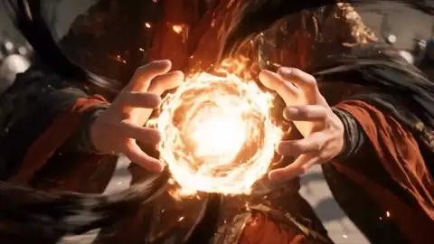

# Wuxia Fire Master Palace Battle — by @Viniai_

[← Back to Community Examples](../../EXAMPLES.md) · Category: Video · Model: `Seedance 2.5`

<a href="https://x.com/Viniai_/status/2124695713238139200"></a>

**[▶ Watch the full video on X](https://x.com/Viniai_/status/2124695713238139200)** — the preview above is a short silent clip.

Source: **[@Viniai_ on X](https://x.com/Viniai_/status/2124695713238139200)** · Creator: [Vini](https://x.com/Viniai_)

## Prompt

```text
Master description:

Epic Chinese wuxia dark-fantasy battle film, ultra-photoreal, 16:9 cinematic widescreen, 24fps, blockbuster VFX, heavy motion blur and fast handheld camera. The Fire Master: a lone young warrior with long black hair, wearing a flowing dark crimson-red and black layered robe with gold embroidery, wide sleeves and a hood that he raises later; he controls fire with his bare hands and fights with martial-arts moves. Enemies: hundreds of imperial soldiers in dark iron lamellar armor and helmets, holding swords, spears and shields. Location: a huge ancient Chinese imperial palace courtyard paved with giant grey stone slabs, tall stone pillars, wide stone staircases leading up to a grand palace hall with curved tiled roofs, a massive palace wall and gate, dramatic overcast sky with sunbeams. Grade: desaturated warm grey-brown with intense orange-white fire highlights, dust, embers and smoke everywhere.

Sound (every clip): loud, crisp, full-range blockbuster sound design, no music bed, no dialogue. Roaring fire whooshes, deep sub-bass explosions, stone cracking and debris, metal armor clanks, soldiers' battle cries, whip-pan whooshes on every cut, a constant low rumble of the army.

CLIP 1 (0–10s): The fire awakens

Shot 1 (0–1.5s): extreme close-up of his hands, he cups a small glowing white-hot fireball between his palms, then crushes it tight and light bursts through his fingers. Shot 2 (1.5–3s): wide shot of the courtyard, he stands alone surrounded by a circle of soldiers; a giant ring of fire explodes outward from him across the stone floor. Shot 3 (3–4s): high angle, the shockwave throws soldiers flying back, leaving a black scorched ring on the stones. Shot 4 (4–6.5s): fast tracking close combat, he punches with flaming fists and spins a sweeping fire kick, blazing arcs slicing through the soldiers. Shot 5 (6.5–7.5s): he leaps and slams his fist into the ground, the stone slabs crack and a geyser of fire erupts, launching soldiers into the air. Shot 6 (7.5–10s): he dashes forward with fire trails from his hands and feet, flying knee and fire punch into an armored soldier.
Sound: a deep low hum and crackle as the fireball forms, a tight compressed boom when he crushes it, a massive ring-of-fire WHOOMPH with sub-bass and roaring flames, bodies thudding on stone, armor clattering, fast punch whooshes and fire bursts on every hit, a huge ground-slam boom with stone cracking, a fire geyser roar.

CLIP 2 (10–20s): Up the palace stairs

Shot 1 (10–11.5s): he races up the wide palace staircase, soldiers charging down at him, fire blasting from his feet as he jumps. Shot 2 (11.5–12.5s): he hurls a huge comet-like fireball down the stairs into the army, a massive explosion. Shot 3 (12.5–13.5s): drone shot above the staircase, rows of fireballs slam into the soldiers and one blast leaves a glowing white-hot crater. Shot 4 (13.5–15s): he lands between two tall stone pillars, cracked stone around his feet. Shot 5 (15–16s): two long serpent-like whips of fire swirl out from his arms in giant loops, burning orbs spinning at their ends, like blazing wings. Shot 6 (16–17s): two walls of fire race forward along the stone road toward the palace gate. Shot 7 (17–18.5s): a giant spinning vortex ring of fire hits the palace gate, the wall cracks and crumbles. Shot 8 (18.5–20s): he stands still with his hood up, both hands glowing with fireballs, black scorch marks spreading from his feet.
Sound: footsteps pounding up stone stairs, a soldiers' war cry, a whooshing roar as the fireball flies and a huge explosion boom, a rapid rain of bomb-like blasts from above, a heavy landing thud with stone cracking, long swishing fire-whip whooshes, a rushing roar of fire walls, a deep rumbling vortex spin and the palace wall crumbling, then a tense low fire crackle.

CLIP 3 (20–30s): The final strike

Shot 1 (20–21s): he levitates into the sky above the courtyard, arms spread wide, hundreds of fireballs appear behind him in a giant radiating halo. Shot 2 (21–22.5s): the fireballs rain down like meteors on the soldiers, explosions bursting all over the courtyard. Shot 3 (22.5–23.5s): extreme wide aerial shot, a colossal swirling sphere of fire hangs above the courtyard over the whole army. Shot 4 (23.5–25s): the fire sphere slams down and explodes into a blinding white-orange flash and a huge dome-shaped blast spreading across the courtyard. Shot 5 (25–28.5s): very wide aerial shot of the whole palace city, a giant fire tornado twists up into the sky from the courtyard, dust clouds and debris rolling across the rooftops. Shot 6 (28.5–30s): top-down drone shot rising slowly, a huge black crater in the middle of the courtyard with the tiny figure of the Fire Master standing alone at its center as the dust settles.
Sound: a rising choir of fire whooshes as the halo of fireballs ignites, a rapid barrage of meteor impacts and explosions, a deep pulsing roar of the giant sphere, then a massive world-shaking explosion with a long sub-bass boom and a high ringing tone, a howling fire-tornado roar with wind and debris, then everything fades to soft falling embers and a low wind.
```

## Try it

Paste the prompt into **[vinano.ai](https://vinano.ai?utm_source=github&utm_medium=readme&utm_campaign=awesome-image-video-prompts-updating&utm_content=x-page-try)** to generate your own version.

> The video and prompt belong to @Viniai_ ([original post](https://x.com/Viniai_/status/2124695713238139200)) and are shown here with credit for reference. Creators can ask for changes or removal by opening an issue.
