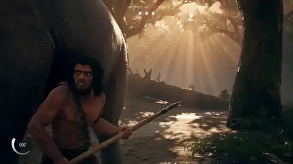

# Early Human Elephant Chase Game Sequence — by @aymducking

[← Back to Community Examples](../../EXAMPLES.md) · Category: Video · Model: `Unknown`

<a href="https://x.com/aymducking/status/2124585905902018757"></a>

**[▶ Watch the full video on X](https://x.com/aymducking/status/2124585905902018757)** — the preview above is a short silent clip.

Source: **[@aymducking on X](https://x.com/aymducking/status/2124585905902018757)** · Creator: [Aymducking │ Ai creator](https://x.com/aymducking)

## Prompt

```text
30-second 16:9 tightly paced open-world action sequence (modified prompt) A player-controlled early-human protagonist (first version of humanity: strong build, long unkempt black hair, heavy brow, animal-hide clothing, recognizable primitive face and proportions) rides a large grey elephant through a dark misty forest. The protagonist carries and uses wooden spears with stone tips throughout. Opponents (other early humans) chase on penguins. High-quality AAA game-engine graphics, reactive animation, interactive physics, wet undergrowth, dense trees, shafts of light, and saturated late-afternoon forest lighting. Non-graphic action, no blood or gore. Persistent elements: Same early-human identity, same elephant, same spears, continuous enemy locations and damage state. 16:9 framing. 0.0–3.5s — Face the danger Frontal three-quarter medium shot of the early-human protagonist standing tense beside the elephant on a wet forest trail, spear held low. Incoming spears strike a nearby tree with sparks and wood chips. The protagonist flinches, ducks, and turns toward a loose roadblock of fallen logs ahead where opponents on penguins wait. The protagonist raises a spear. 3.5–7.0s — Aim and throw Camera moves smoothly around the aiming shoulder into a first-person-style magnified view (circular scope with crosshairs and slight sway). An opposing rider is visible crouched behind a penguin and a fallen log, leaning out. The protagonist throws one spear that impacts the log beside the rider with sparks and debris. The rider recoils and ducks lower, remaining alive. Ammo-style count decreases by one. 7.0–10.5s — The flanking threat Cut to a short threat view: a second opponent on a penguin is only a few meters away, running along the trail with spear raised, shouting “Drop it!” Snap back to close three-quarter view of the protagonist noticing, head turning in alarm, and recoiling behind the elephant as a spear strikes nearby. Armor-style bar drops; a fourth wanted-style star appears. Alert: “POLICE FLANKING.” Objective updates to “MOUNT THE ELEPHANT.” 10.5–16.0s — Scramble onto the elephant Follow closely as the protagonist sprints along the elephant’s left side (urgent posture, quick steps, glance back). “[SHIFT] SPRINT” prompt. At the side, “[E] MOUNT” appears. The protagonist slings the spear, climbs onto the elephant’s back with clear, anatomy-appropriate movement, settles into a riding position, and reaches for control. The penguin rider arrives near the rear and reaches but stays outside. The elephant starts moving with a low rumble. Objective updates to “ESCAPE THE PENGUINS.” 16.0–20.5s — Launch through the gap Switch to third-person chase camera behind and slightly above the elephant. Rear feet kick up water and dirt toward the approaching penguin rider, who jumps aside. The elephant charges forward through the narrow gap, scraping a tree with a jolt, bark sparks, and a folding branch. The protagonist corrects and accelerates onto the open trail. Speed rises from 000 to 085. Brief “VEHICLE DAMAGED” notification; condition bar at 85%. 20.5–24.0s — Look back and throw Brief player-triggered look-back view from the elephant. The protagonist twists, looks behind, and throws a spear out to the side (“from the window” equivalent while riding). Two opponents on penguins are clearly chasing in the same direction; the nearest is only one length behind and closing fast. A second penguin pulls out from the broken roadblock farther back. “[C] LOOK BACK” highlights. On the minimap, two penguin markers track behind the player. Four wanted-style stars flash. 24.0–30.0s — High-speed getaway Return to standard rear chase camera. The elephant accelerates hard between trees and past fleeing wildlife, then power-slides around the next corner (front pointing into the turn, rear sliding naturally). Speed reaches 120 before dropping in the drift. Fast trail movement, dirt spray, body sway, restrained motion blur. The nearest penguin rider enters the same turn immediately behind, clips a root, jolts, and continues pursuit. The protagonist straightens the elephant and accelerates again. End with the elephant racing out of the corner and the penguin rider still close behind. Objective remains “ESCAPE THE PENGUINS”; four stars stay active. No victory banner. Sound and continuity: English dialogue only (“Drop it!”). Spear impacts, wood cracks, hurried footsteps, elephant rumbles and trumpets, penguin calls, tire-like wet trail spray, and approaching pursuit sounds. No subtitles or music. Every camera change reveals identity, a target, an approaching threat, or pursuit information. Keep the elephant’s damage, spear count, character identity, and enemy locations continuous.
```

## Try it

Paste the prompt into **[vinano.ai](https://vinano.ai?utm_source=github&utm_medium=readme&utm_campaign=awesome-image-video-prompts-updating&utm_content=x-page-try)** to generate your own version.

> The video and prompt belong to @aymducking ([original post](https://x.com/aymducking/status/2124585905902018757)) and are shown here with credit for reference. Creators can ask for changes or removal by opening an issue.
