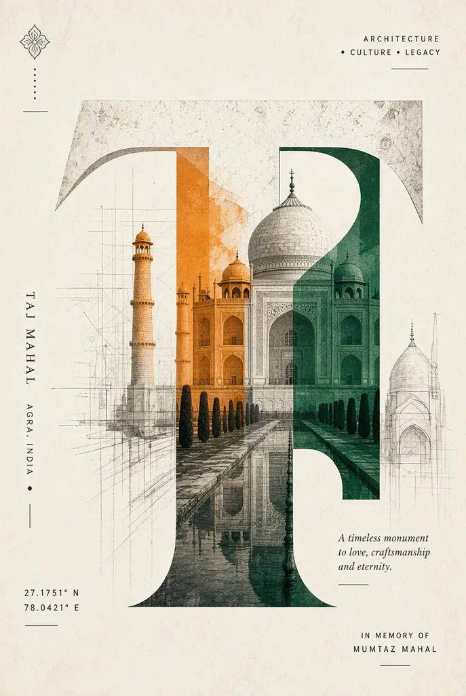

# Oversized Letter Landmark Architecture Poster — by @Aiwithkami

[← Back to Community Examples](../../EXAMPLES.md) · Category: Poster Design · Model: `GPT Image 2.6`

<a href="https://x.com/Aiwithkami/status/2125476933056217417"></a>

Source: **[@Aiwithkami on X](https://x.com/Aiwithkami/status/2125476933056217417)** · Creator: [Kami AI](https://x.com/Aiwithkami)

## Prompt

```text
Create an exceptionally sophisticated, contemporary architectural art poster featuring [LANDMARK NAME], [CITY], [COUNTRY].

1. GIANT TYPOGRAPHIC COMPOSITION

Feature one enormous, oversized uppercase letter associated with the destination name as the central graphic element.

The letter should dominate the composition, extending almost across the entire poster.

Use bold, elegant, geometric typography with distinctive curves and negative spaces.

2. LANDMARK INTEGRATION

Seamlessly integrate a highly detailed architectural photograph or realistic architectural illustration of [LANDMARK NAME] into and across the oversized letter.

The landmark should appear to emerge from the typography, partially overlap its boundaries and interact naturally with its shape.

Preserve the landmark’s authentic architectural details, proportions and recognisable silhouette.

Create an artistic double-exposure effect where the architecture and typography become one unified visual composition.

3. DISTINCTIVE COLOUR TREATMENT

Choose a unique colour palette inspired by the destination’s cultural identity, national colours and architectural character.

Use two or three contrasting colours within the oversized typography.

Apply translucent colour overlays across selected sections of the landmark, creating a beautiful combination of architectural photography, coloured light and graphic shapes.

Every new destination must receive a different colour combination. Never repeat palettes.

4. TEXTURE & BACKGROUND

Use a warm ivory, soft white or subtle textured paper background.

Introduce delicate architectural sketch marks, distressed ink textures, faded photographic grain and subtle print imperfections around the central composition.

Keep the surrounding space clean and uncluttered.

5. EDITORIAL TYPOGRAPHY

Include the following information:

[LANDMARK NAME]

[CITY NAME]

[COUNTRY NAME]

Add small vertical typography along one side, geographical coordinates and a subtle destination-inspired tagline.

Use sophisticated editorial typography with carefully balanced spacing.

6. ART DIRECTION

Luxury architectural editorial design, experimental typography, architectural double exposure, contemporary Swiss graphic design, oversized letterforms, cinematic monochromatic photography, translucent colour blocking and minimalist gallery poster aesthetics.

7. FINAL PRESENTATION

Create a visually striking, intellectual and artistic collectible landmark poster.

The architecture must remain recognisable while becoming an integral part of the oversized letter.

Vertical 4:5 composition, premium art-print quality, exceptional visual balance and sophisticated negative space.

Avoid ordinary travel-poster layouts, decorative clutter, excessive colours and generic typography.
```

## Try it

Paste the prompt into **[vinano.ai](https://vinano.ai?utm_source=github&utm_medium=readme&utm_campaign=awesome-image-video-prompts-updating&utm_content=x-page-try)** to generate your own version.

> The image and prompt belong to @Aiwithkami ([original post](https://x.com/Aiwithkami/status/2125476933056217417)) and are shown here with credit for reference. Creators can ask for changes or removal by opening an issue.
