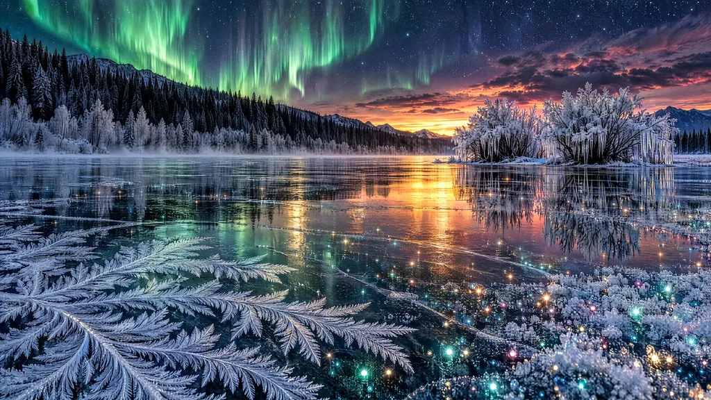

# Aurora Over a Frozen Lake at Night — by @churvikv

[← Back to Community Examples](../../EXAMPLES.md) · Category: Photography · Model: `GPT Image 2.5 Sunburst`

<a href="https://x.com/churvikv/status/2125685392053846024"></a>

Source: **[@churvikv on X](https://x.com/churvikv/status/2125685392053846024)** · Creator: [Viki](https://x.com/churvikv)

## Prompt

```text
Photorealistic magical frozen lake at night under the aurora, wide 16:9 panoramic composition, ultra-detailed. Full bleed, no frame, no border, no lettering.

SKY: a deep indigo star-filled night vault across the upper third, pierced by tall vertical curtains of aurora borealis in luminous emerald, mint and pale jade, their frayed strands hanging and curling like combed light, brightest above the left ridge. Low on the right horizon a warm afterglow of coral, rose and burnt orange streaks through dark cloud bands, fading upward into violet.

FOREST: a long ridge of dense black pine silhouettes spans the middle left, its slopes dusted with frost, needle tips rimmed in white. Paler frosted trees stand in front of it, and a thin veil of ground mist drifts across the shoreline.

BUSHES: right of centre, two large ornamental shrubs are fully encased in white frost, every leaf and branch furred with rime, long glassy icicles hanging from the lower twigs, dark twig fans splaying at their bases. Their shapes reflect perfectly in the ice below.

LAKE: the lower half is smooth black ice, its surface streaked with wind-polished sheen and carrying a broad warm gold and amber reflection of the sunset glow down the centre, plus dark mirror reflections of the shrubs and treeline.

SPARKLES: hundreds of tiny multicoloured light points — turquoise, mint, amber, magenta, pale blue — lie scattered across the ice like fairy lights under the surface, densest across the lower right where the ice turns to sparkling granular snow, glittering in tight clusters.

FOREGROUND: the lower left is dominated by enormous frost fern crystals, flat white branching fronds with fine feathered leaflets radiating across the dark ice, sharply crystalline, catching cold blue light.

PALETTE: deep indigo, emerald, mint, coral orange, warm gold, ice white, charcoal black, turquoise. Hyper-detailed, luminous, high dynamic range.
```

## Try it

Paste the prompt into **[vinano.ai](https://vinano.ai?utm_source=github&utm_medium=readme&utm_campaign=awesome-image-video-prompts-updating&utm_content=x-page-try)** to generate your own version.

> The image and prompt belong to @churvikv ([original post](https://x.com/churvikv/status/2125685392053846024)) and are shown here with credit for reference. Creators can ask for changes or removal by opening an issue.
