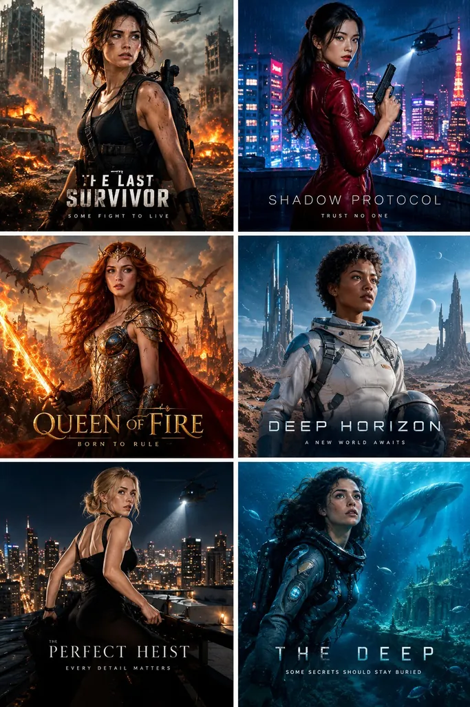

# Six Heroine Movie Posters Grid — by @Just_Anika_Here

[← Back to Community Examples](../../EXAMPLES.md) · Category: Poster Design · Model: `GPT Image 2.5`

<a href="https://x.com/Just_Anika_Here/status/2125627017622323425"></a>

Source: **[@Just_Anika_Here on X](https://x.com/Just_Anika_Here/status/2125627017622323425)** · Creator: [Anika](https://x.com/Just_Anika_Here)

## Prompt

```text
Create a premium collection of SIX different Hollywood movie posters arranged in an exact 2-column × 3-row grid.

Each panel must feature a completely different adult female protagonist, unique face, hairstyle, outfit, action pose, movie genre, and cinematic environment.

Six Movie Concepts:

Action: Fierce female warrior in a burning futuristic city.
Spy Thriller: Female secret agent on a neon-lit Tokyo rooftop.
Fantasy: Powerful warrior queen with a flaming sword and dragons.
Sci-Fi: Female astronaut exploring a mysterious alien planet.
Crime Thriller: Female master thief escaping a luxury skyscraper.
Underwater Adventure: Female explorer discovering an ancient sunken civilization.

Visual Style: Epic Hollywood blockbuster movie posters, dramatic action poses, breathtaking environments, cinematic lighting, rich colors, photorealistic characters, premium theatrical poster design.

Layout: Exactly six separate posters, 2 columns × 3 rows, equal-sized panels, clean spacing, perfectly aligned.

IMPORTANT: Six completely different heroines, six different movie worlds. Every panel must look like an individual blockbuster movie poster. No repeated faces, outfits, or backgrounds. Ultra-realistic, exceptionally detailed, 8K quality.
```

## Try it

Paste the prompt into **[vinano.ai](https://vinano.ai?utm_source=github&utm_medium=readme&utm_campaign=awesome-image-video-prompts-updating&utm_content=x-page-try)** to generate your own version.

> The image and prompt belong to @Just_Anika_Here ([original post](https://x.com/Just_Anika_Here/status/2125627017622323425)) and are shown here with credit for reference. Creators can ask for changes or removal by opening an issue.
