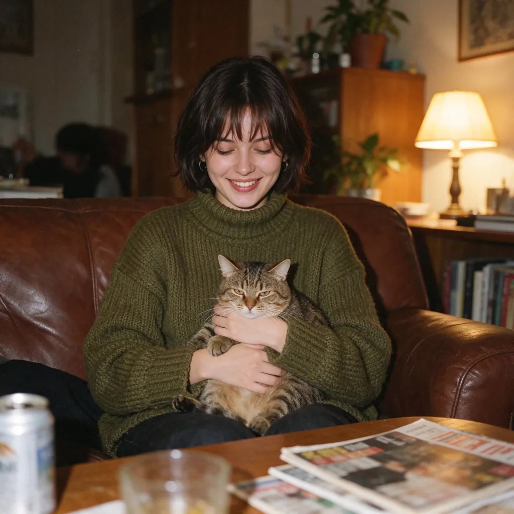

# Candid Vintage Film Photo with a Sleepy Cat — by @harboriis

[← Back to Community Examples](../../EXAMPLES.md) · Category: Photography · Model: `Seedream 5.5`

<a href="https://x.com/harboriis/status/2125602367051796771"></a>

Source: **[@harboriis on X](https://x.com/harboriis/status/2125602367051796771)** · Creator: [Harboris](https://x.com/harboriis)

## Prompt

```text
Create an ultra-realistic candid vintage film photograph, vertical 9:16 composition.

A beautiful young woman with a short, naturally messy dark brown bob haircut, soft bangs, fair skin, delicate facial features, and a warm genuine smile is sitting comfortably on a vintage brown leather sofa in a cozy living room.

She is wearing an oversized olive-green chunky knitted turtleneck sweater with long sleeves. She is gently holding a fluffy brown tabby cat in her lap with both arms. The cat is relaxed and looking directly toward the camera with a slightly sleepy expression.

The woman has her eyes gently closed and is smiling naturally, showing her teeth. Her posture is relaxed and comfortable, creating a genuine heartwarming moment between her and her cat.

The room has a lived-in vintage atmosphere. A warm glowing table lamp sits on a wooden side table in the background. Behind her are wooden cabinets, houseplants, books, and soft household details. Another person is faintly visible sitting in the background, out of focus.

In the foreground, a wooden coffee table holds a partially visible aluminum drink can, a transparent glass, and vintage magazines.

Photography style: authentic 35mm analog film photography, nostalgic 1990s home photography, warm amber tones, soft tungsten lighting, natural film grain, slightly faded colors, gentle atmospheric haze, realistic skin texture, imperfect candid framing, shallow depth of field.

Camera: medium portrait shot, eye-level perspective, natural indoor snapshot, soft direct flash mixed with warm lamp lighting.

The overall feeling should be cozy, intimate, spontaneous, nostalgic, and genuinely heartwarming.

Extremely photorealistic, no CGI, no illustration, no artificial posing.
```

## Try it

Paste the prompt into **[vinano.ai](https://vinano.ai?utm_source=github&utm_medium=readme&utm_campaign=awesome-image-video-prompts-updating&utm_content=x-page-try)** to generate your own version.

> The image and prompt belong to @harboriis ([original post](https://x.com/harboriis/status/2125602367051796771)) and are shown here with credit for reference. Creators can ask for changes or removal by opening an issue.
