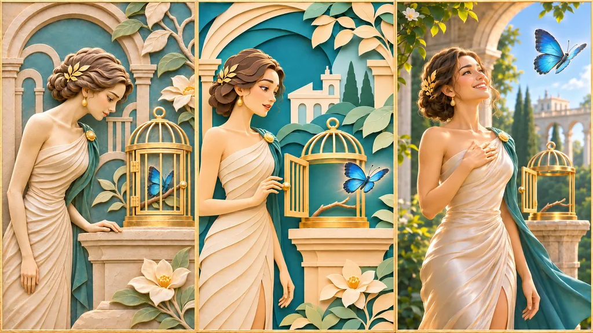

# Three-Style Triptych: Setting a Butterfly Free — by @yeshanghui

[← Back to Community Examples](../../EXAMPLES.md) · Category: Illustration & 3D · Model: `GPT Image`

<a href="https://x.com/yeshanghui/status/2125176141216710837"></a>

Source: **[@yeshanghui on X](https://x.com/yeshanghui/status/2125176141216710837)** · Creator: [HUI](https://x.com/yeshanghui)

## Prompt

```text
【画面规格与整体艺术风格】

16:9横向高级艺术叙事三联画，电影级构图，三个纵向画面通过纤细的香槟金色边框分隔，分别采用古典彩色浅浮雕艺术、高级多层立体剪纸艺术、电影级欧美风格化写实3D艺术。

讲述同一位女性发现被囚禁的蓝色蝴蝶、主动打开笼门释放蝴蝶、最终见证蝴蝶重获自由的完整故事。三个画面从左至右形成清晰的情绪递进：怜惜、希望、喜悦。

三种美术风格具有明确的材质、造型、空间和光影差异，同时保持统一的色彩体系、人物形象、服装设计、建筑风格及核心道具。整体优雅、浪漫、精致、干净，具有高级艺术收藏品的视觉质感。

【统一人物设计】

同一位30岁左右的东亚与欧美混血成年女性，具有成熟优雅的高级时装模特气质，精致鹅蛋脸，立体自然的五官，深棕色眼睛，柔和的下颌线，自然丰满的嘴唇，细腻柔和的面部轮廓。

标准成年女性模特身材，约7.5—8头身，自然丰满的上身，纤细匀称的腰部，修长四肢，真实自然的肩宽、胸腰胯比例以及人体骨骼肌肉结构。避免夸张的头部尺寸、过度收腰和异常拉长的四肢。

深棕色低盘发，采用自然饱满的卷曲发束，发型精致但不过于复杂，左侧佩戴小型古金色叶片发饰，搭配简洁的金色水滴耳饰。

身穿香槟白色不对称单肩修身长裙，优雅的斜向垂坠领口，自然收腰，单侧裙摆开叉，适度展现成熟女性的性感与优雅。人物自身左肩固定圆形金色胸针及孔雀蓝披肩，右肩和右上臂自然露出。披肩沿身体侧后方自然垂落，不缠绕手臂，不遮挡关节。

三幕保持完全一致的人物身份、年龄、脸型、五官比例、发型、服装剪裁、领口、腰线、开叉位置及配饰，仅根据不同艺术媒介改变形体构建与材质表现。

【第一幕：发现囚禁——古典彩色浅浮雕艺术】

画面采用高级古典彩色浅浮雕艺术，以经过精细打磨的暖象牙白石材、低饱和孔雀蓝矿物颜料及柔和古金色装饰构成。

女性位于画面左侧，站在古典石质台座旁，身体自然朝向右侧的笼子，上半身从髋部轻微前倾，双肩放松，颈部保持自然长度，下巴轻微降低。

人物双眼自然睁开，准确注视笼子内部的蓝色蝴蝶，眉毛内侧轻微抬起，嘴唇自然闭合，神态安静、温柔、关切，流露出对被囚禁生命的怜惜，没有明显笑意。

人物自身左手自然轻搭在石台边缘，左肩、左上臂、左肘、左前臂、左腕与左手正确连接。掌根轻触台面，四根长指自然延伸并轻微弯曲，拇指位于正确的掌侧位置。

右臂自然垂落于身体右侧，右手靠近大腿外侧，手指自然放松。双手大小与人物头部、前臂及整体身体比例协调，采用纤细但真实的成年女性手部比例，不出现过长或过大的手掌。

石台上放置一只简洁的古金色圆顶笼子，顶部具有单一圆形提环，底部具有完整圆形底座，正面矩形笼门完全关闭。门框左侧具有上下两个固定铰链，右侧具有一个小型圆形拉钮。

笼内一只蓝色大闪蝶停驻在短枝上，翅膀自然半收拢，前方笼条形成合理的遮挡关系。

人物、礼服、头发、植物、建筑、笼子及蝴蝶全部采用统一的彩色浅浮雕雕刻工艺。蝴蝶使用蓝色矿物颜料彩绘石雕表现，笼子采用柔和哑光鎏金雕刻材质。

背景为古典拱形回廊、孔雀蓝色墙面、简洁雕刻植物及少量象牙白花卉，采用完整的大面积造型和清晰的雕刻轮廓。

人物面部、颈部、肩膀及手臂具有细腻光滑的雕塑表面，去除龟裂、密集颗粒、重复压花和细碎石材纹理。礼服采用自然完整的雕刻褶皱，通过真实浮雕厚度、柔和侧光与实体阴影体现雕塑艺术质感，而不是依靠粗糙纹理。

【第二幕：释放希望——高级多层立体剪纸艺术】

画面采用高级多层立体剪纸艺术，所有人物、道具及环境均由精致的哑光艺术卡纸构建，具有清晰的纸张切割边缘、真实的层叠厚度、柔和的层间投影及完整的色块。

同一位女性站在石台左侧，已经主动打开笼门，身体从第一幕的轻微前倾恢复到较为直立的状态，重心自然向后转移，为蝴蝶飞出预留空间。

人物头部自然朝向右下方，双眼瞳孔准确注视刚刚飞出笼门的蓝色蝴蝶。眉毛轻微抬起，眼睛自然睁开，嘴唇微微张开，流露出温柔、细腻的惊喜与期待。

表情比第一幕更加明亮，但不如第三幕那样充分释放喜悦。不夸张惊呼，不仰头，不看向背景。

人物自身右上臂自然靠近躯干，右肘舒适弯曲，右前臂朝向已经开启的笼门。

右手处于刚刚松开圆形拉钮的瞬间，距离拉钮约2—3厘米。拇指与食指自然放松分离，中指、无名指、小拇指保持自然弯曲。五根手指结构完整、长度准确、关节方向正确，手指之间具有合理的间距和透视遮挡。

手腕自然延续前臂方向，不出现突然折弯、异常扭转或手指穿过道具。

左臂自然垂落于身体侧面，左手掌心朝向身体，五指放松微曲，小拇指明显短于中指。

人物裸露的右肩、锁骨、胸部、三角肌及上臂具有完整连续的自然人体结构。采用干净平滑的暖象牙色艺术卡纸塑形，不出现多余肩带、皮肤划痕、纸张拼接线、异常肌肉线条及环状袖口。

服装保持与第一幕和第三幕完全相同的单肩礼服结构，左肩固定金色胸针与孔雀蓝披肩，右肩自然露出。

石台上保留相同尺寸和结构的圆顶笼子。笼门通过左侧上下两个铰链向外、向画面左侧开启约105度，圆形拉钮位于门框自由边。门洞保持完整畅通，出口平面不存在残留笼条，后方笼条与门框具有正确的空间关系。

一只蓝色纸艺蝴蝶刚刚完整通过门洞，位于出口前方约10—15厘米处，开始向画面右侧飞行。蝴蝶与门框、人物手指及笼条之间保持明确的空间距离，不发生穿插。

蝴蝶采用多层蓝色艺术卡纸构建，具有两对正确连接的翅膀、单一身体及一对触角。翅膀呈自然展开状态，近侧与远侧翼面具有合理的透视差异，保留清晰的纸张切割边缘及层叠结构。

笼子采用金赭色哑光厚卡纸制作，不使用真实金属反光。蝴蝶不使用真实昆虫鳞片材质和发光特效。

背景由层叠的孔雀蓝色拱形结构、象牙白色古典建筑、简洁植物剪影及少量立体纸艺花卉构成。

纸张表面干净、平整、哑光，仅保留极轻微的自然纸张质感。减少细碎纸片、密集压花、重复纹理及装饰线条，通过完整色块、纸张厚度和层间阴影体现高级立体剪纸艺术。

【第三幕：自由与喜悦——电影级欧美风格化写实3D】

电影级欧美风格化写实3D艺术，Unreal Engine级次世代角色品质，精致PBR材质，真实自然的人体结构、柔和电影级光影与完整三维空间。

同一位女性站在阳光照耀的古典花园回廊中，身体自然舒展，微微朝向蝴蝶飞行的方向转动，肩膀放松，脊柱自然延伸，身体重心稳定。

人物自身右手掌轻轻贴在锁骨下方的上胸礼服表面，表现看到蝴蝶重获自由后发自内心的喜悦与感动。

右上臂自然靠近躯干，右肘朝向身体侧下方，右前臂斜向胸前，手腕角度自然。四根长指朝斜上方放松排列，拇指位于正确掌侧。手掌与布料具有真实接触关系，不出现手指拥挤、交叉、穿模或异常关节。

左臂自然垂落，左手靠近大腿外侧，手指轻微弯曲，姿态优雅而放松。

人物头部轻微朝右上方转动，颈部自然，下巴适度抬起。双眼睁开，准确注视正在自由飞翔的蓝色蝴蝶。

眉毛自然舒展，嘴角明显上扬，适当露出少量上排牙齿，面颊肌肉随微笑自然抬起，眼睑与笑容协调。表现真实、温暖、具有感染力的喜悦、欣慰与释然，成为整幅三联画的情绪高潮。

不闭眼，不夸张大笑，不过度仰头，不刻意挺胸，不使用僵硬的时尚摆拍姿势。

一只蓝色大闪蝶位于人物右上方的开阔天空中，具有较大的视觉占比和清晰的飞行姿态。

蝴蝶必须采用与第三幕人物、植物及环境完全一致的电影级风格化写实3D建模与PBR材质渲染。

蝴蝶具有正确的两对翅膀，共四片翼面：左前翅、左后翅、右前翅、右后翅。前翅较大，后翅较小，左右结构相互对应，四片翅膀均正确连接于胸部。单一头部、胸部及腹部，两根自然纤细的触角，六条细足自然收拢于身体下方。

采用接近背面的三分之四动态飞行视角，左右翼面清晰可辨，近侧与远侧翅膀具有合理的透视面积及自然遮挡关系。

翅膀轻薄，具有自然弧度、连续变化的蓝色虹彩、细腻鳞片质感、柔和翼脉及自然深色翼缘。不存在插画式粗黑描边、分块式翼面、纸张层叠、额外翅膀及二维贴纸感。

蝴蝶受到与人物及花园相同方向、相同色温的自然阳光照射，具有真实立体体积、合理的受光与阴影，以及符合空间距离的景深表现。

人物右侧的石台上保留同一个打开的空笼，笼门与第二幕保持相同的左侧铰链及向外开启方向。统一圆顶、提环、笼条、底座、门框、拉钮和笼内短枝。

笼子采用真实香槟金金属PBR材质，柔和完整的金属高光与合理的环境反射，不出现大量细碎反光点。

背景为开阔的欧洲古典花园、暖色石质拱门、自然绿色植物、少量花卉、远处古典建筑及清澈蓝天。

仅在拱门左上方保留极少量白色花朵，其余区域以完整绿色叶片及柔和背景虚化为主。减少密集花卉、细碎光斑和重复植物纹理，为人物与蝴蝶保留充足的视觉空间。

温暖阳光从画面左上方自然照亮女性面部、肩膀和丝质礼服。香槟白色礼服具有真实柔和的丝绸质感、大面积自然高光及符合重力的布料褶皱。孔雀蓝披肩在微风中自然向后飘动，少量头发随风轻微摆动。

【整体构图、配色与质量控制】

统一使用香槟白、孔雀蓝、古金色、宝石蓝、暖石色及自然植物绿。

三个画面采用相近的平视中全景构图，统一人物头部大小、身体比例、石台高度及笼子尺寸。人物动作从轻微前倾、主动释放过渡到自然舒展，情绪从安静怜惜逐渐递进至温柔惊喜和发自内心的喜悦。

第一幕通过雕刻体积、柔和边缘和实体阴影体现浅浮雕艺术；第二幕通过完整色块、清晰纸张切边及层叠阴影体现纸艺风格；第三幕通过完整三维形体、自然材质与电影级光影体现真实生命感。

严格控制所有人物的真实人体解剖结构，确保肩颈、锁骨、三角肌、上臂、前臂、肘部、手腕及手掌自然连接。

每只手恰好具有五根结构正确的手指，手掌尺寸与人体比例协调，拇指位置正确，中指通常最长，小拇指明显较短，指关节弯曲自然，允许符合透视的正常遮挡，避免强行展示全部手指。

减少细碎纹理、重复图案、粗糙颗粒、密集发丝、复杂布料褶皱、杂乱高光及过多装饰。强调干净完整的形体、清晰优雅的轮廓、自然柔和的材质和准确的空间关系。

高级艺术三联画，博物馆级艺术质感，电影级构图，浪漫主义美学，成熟优雅的女性形象，三种鲜明且高度和谐的艺术媒介，完整而直观的故事表达，细腻自然的情绪递进，高清画质，无文字，无水印。

【负面提示词】

多余手指，缺失手指，四指手掌，六指手掌，融合手指，手指等长，过长小拇指，反向拇指，错误左右手，手掌过大，手掌过小，异常手指比例，畸形指关节，折断手腕，扭曲前臂，反向肘关节，肩臂错位，手指穿模，手掌悬空，异常肩胸线条，皮肤划痕，透明肩带，多余肩带，多余袖口，皮肤拼接线，夸张锁骨，过长颈部，异常颈部肌肉，头身比例错误，大头娃娃，异常身体比例，过度收腰，僵硬姿态，夸张仰头，闭眼，斗鸡眼，瞳孔方向错误，视线偏离蝴蝶，夸张惊呼，僵硬微笑，表情雷同，人物身份变化，服装结构不一致，披肩穿模，笼子悬空，重复笼门，重复拉钮，错误铰链，笼门开启方向不一致，门洞阻塞，笼条交叉，蝴蝶穿过笼条，重复蝴蝶，多余翅膀，缺失翅膀，单侧重复翼面，错误翅膀连接，二维插画蝴蝶，纸艺蝴蝶出现在第三幕，粗黑描边，矢量图案，平面贴纸感，石材龟裂，密集碎纹，重复压花，粗糙颗粒，重复纸张纹理，过多白花，密集植物，杂乱背景，细碎光斑，金属碎光，过度反射，密集布料褶皱，魔法粒子，发光射线，过度锐化，文字，水印。
```

## Try it

Paste the prompt into **[vinano.ai](https://vinano.ai?utm_source=github&utm_medium=readme&utm_campaign=awesome-image-video-prompts-updating&utm_content=x-page-try)** to generate your own version.

> The image and prompt belong to @yeshanghui ([original post](https://x.com/yeshanghui/status/2125176141216710837)) and are shown here with credit for reference. Creators can ask for changes or removal by opening an issue.
