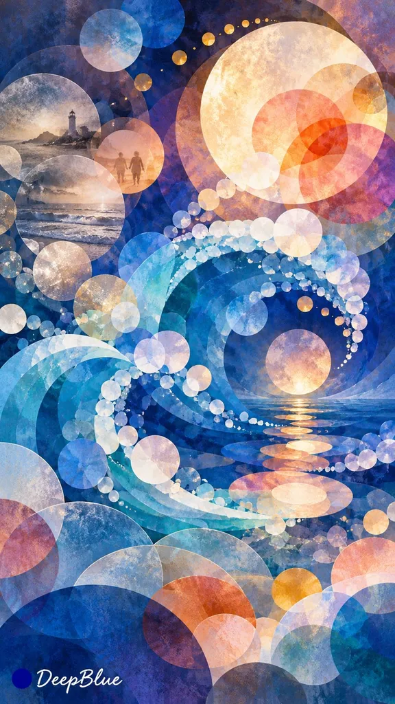

# Everything Can Be a Circle (Kandinsky Abstraction) — by @DeepBlueX0

[← Back to Community Examples](../../EXAMPLES.md) · Category: Illustration & 3D · Model: `GPT Image 2.6`

<a href="https://x.com/DeepBlueX0/status/2125511278970257598"></a>

Source: **[@DeepBlueX0 on X](https://x.com/DeepBlueX0/status/2125511278970257598)** · Creator: [DeepBlue深藍](https://x.com/DeepBlueX0)

## Prompt

```text
《圓的無限可能》× 康定斯基幾何抽象 × 萬物形態轉譯 × 實驗藝術。

每張獨立隨機抽取一個具有創作價值的主題，將其核心特徵、內在結構或情感關係轉譯為圓形藝術。

以大小不一的圓形作為基本視覺單元，透過尺度、疏密、排列、嵌套、透明疊色與空間關係，建立具有主題意義的視覺秩序。

根據抽中的主題，自由選擇最適合的藝術媒介、材質、色彩、構圖與呈現方式，探索平面與立體、具象與抽象之間的無限可能。

每張具有不同的創意機制與視覺表現，形成具有獨立藝術價值的原創作品。

9:16直式獨立單圖，每張分別生成，不自動裁切。
左下深藍色實心圓點，後接白色自然手寫體「DeepBlue」。

n=9
```

## Try it

Paste the prompt into **[vinano.ai](https://vinano.ai?utm_source=github&utm_medium=readme&utm_campaign=awesome-image-video-prompts-updating&utm_content=x-page-try)** to generate your own version.

> The image and prompt belong to @DeepBlueX0 ([original post](https://x.com/DeepBlueX0/status/2125511278970257598)) and are shown here with credit for reference. Creators can ask for changes or removal by opening an issue.
