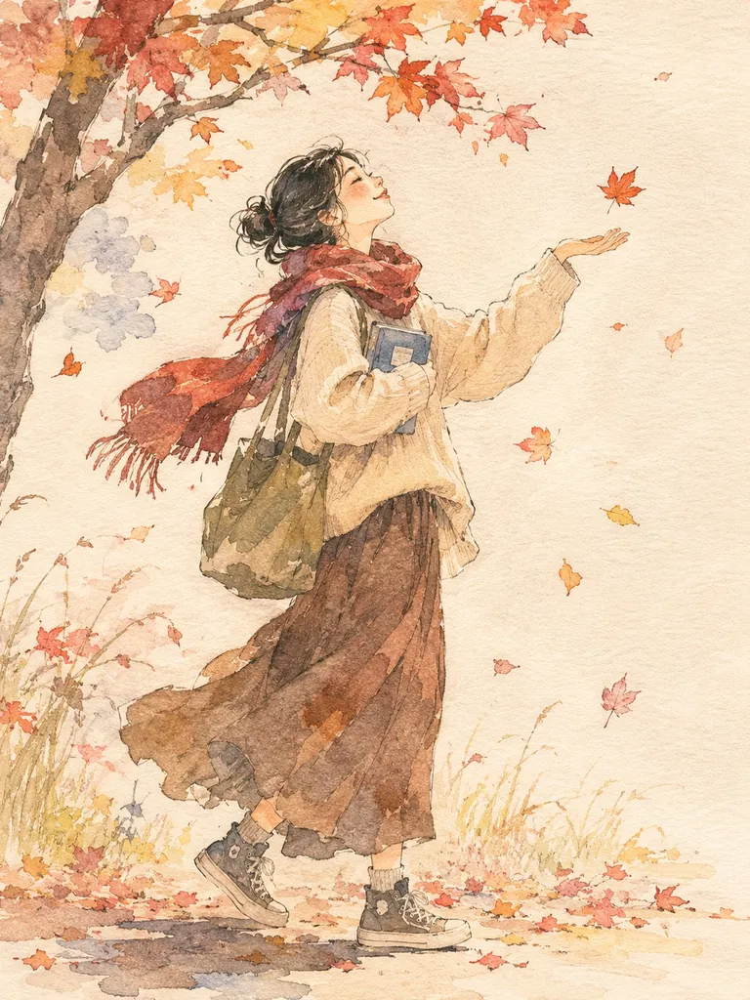

# Japanese Watercolor Everyday Moment — by @Goodmanprotocol

[← Back to Community Examples](../../EXAMPLES.md) · Category: Illustration & 3D · Model: `GPT Image 2.6`

<a href="https://x.com/Goodmanprotocol/status/2125586366348345532"></a>

Source: **[@Goodmanprotocol on X](https://x.com/Goodmanprotocol/status/2125586366348345532)** · Creator: [Saul Goodman](https://x.com/Goodmanprotocol)

## Prompt

```text
Create a beautiful, hand-painted Japanese watercolor illustration capturing a poetic, candid moment from everyday life. The artwork should have the delicate charm of traditional Japanese illustration, combined with contemporary fashion sketching and expressive watercolor techniques.

1. ART STYLE & TECHNIQUE

Use soft, translucent watercolor washes, delicate pencil outlines, loose ink detailing, and subtle hand-drawn imperfections. Incorporate visible watercolor pigment variations, gentle color bleeding, layered brushstrokes, and beautifully textured handmade ivory paper. The illustration should feel genuinely painted by a skilled traditional artist, not digitally rendered.

2. SUBJECT & STORYTELLING

Depict a young woman in an elegant yet natural everyday moment. She could be walking beneath a windblown umbrella, enjoying autumn leaves, standing by the seaside, catching falling petals, or playfully holding her hat against a gentle breeze.

Capture spontaneous movement, graceful body language, flowing clothing, and subtle facial expressions. Her outfit should feature beautiful contemporary Japanese-inspired street fashion, including oversized shirts, flowing skirts, knitted sweaters, scarves, and understated accessories.

3. COLOR PALETTE & ATMOSPHERE

Use a sophisticated palette of muted pastel shades, dusty rose, warm beige, soft sage green, powder blue, faded mustard, and earthy browns. Keep the background predominantly warm ivory with subtle paper grain, generous negative space, and minimal environmental details.

4. COMPOSITION & DETAILS

Create a full-body or three-quarter composition with an organic, editorial illustration layout. Add delicate environmental elements such as drifting autumn leaves, flower petals, gentle rain, birds, grass, or flowing fabric to create movement and atmosphere.

Include subtle ground shadows and loose watercolor washes beneath the subject. Avoid overly detailed backgrounds or heavy outlines.

5. FINAL AESTHETIC

The finished artwork should feel whimsical, nostalgic, peaceful, uplifting, and effortlessly elegant — like a page from a beautifully illustrated Japanese art journal.

Authentic traditional watercolor appearance, delicate artistic craftsmanship, natural proportions, expressive movement, exquisite paper texture, understated beauty, and timeless editorial illustration.

Aspect ratio: 3:4 or 4:5.
Quality: High-detail traditional watercolor artwork, no photorealism, no 3D rendering, no digital gloss, no watermark.
```

## Try it

Paste the prompt into **[vinano.ai](https://vinano.ai?utm_source=github&utm_medium=readme&utm_campaign=awesome-image-video-prompts-updating&utm_content=x-page-try)** to generate your own version.

> The image and prompt belong to @Goodmanprotocol ([original post](https://x.com/Goodmanprotocol/status/2125586366348345532)) and are shown here with credit for reference. Creators can ask for changes or removal by opening an issue.
