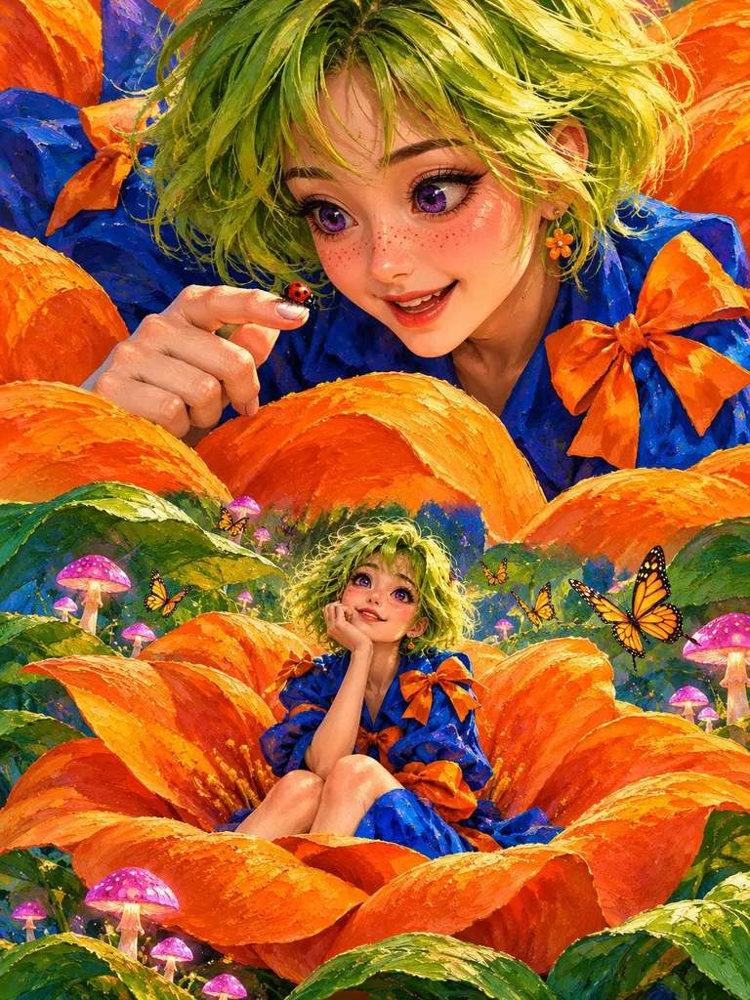

# Anime Surreal Oil Painting in a Giant Flower — by @Just_Anika_Here

[← Back to Community Examples](../../EXAMPLES.md) · Category: Illustration & 3D · Model: `GPT Image 2.5`

<a href="https://x.com/Just_Anika_Here/status/2125779071837585465"></a>

Source: **[@Just_Anika_Here on X](https://x.com/Just_Anika_Here/status/2125779071837585465)** · Creator: [Anika](https://x.com/Just_Anika_Here)

## Prompt

```text
{
  "aspect_ratio": "3:4",
  "prompt": "Create a breathtaking Japanese anime-inspired surreal oil painting featuring a playful young adult Japanese woman with short lime-green hair, oversized expressive violet eyes, round rosy cheeks, unusual tiny freckles and a mischievous smile. She is sitting gracefully inside the heart of an impossibly enormous blooming orange flower, surrounded by gigantic overlapping orange petals that frame her face beautifully. She leans forward playfully, holding a tiny ladybug on her fingertip while looking directly at it with curious fascination. Enormous lush green leaves curve around the flower, with miniature glowing pink mushrooms, delicate butterflies and tiny floating pollen particles scattered throughout the magical environment. Use an imaginative slightly elevated three-quarter camera angle, creating beautiful depth and a captivating composition. She wears a vivid cobalt-blue outfit decorated with oversized orange bows that contrast beautifully against the lime-green foliage and orange petals. Vibrant orange, cobalt blue, lime green, violet and pink color palette. Rich traditional oil painting technique, thick expressive textured brush strokes, whimsical surrealism, bold color blocking, intricate painterly details, extraordinary artistic atmosphere, highly imaginative premium editorial illustration. Single continuous composition, one scene, no panels, no borders, no split screen, no text, no watermark."
}
```

## Try it

Paste the prompt into **[vinano.ai](https://vinano.ai?utm_source=github&utm_medium=readme&utm_campaign=awesome-image-video-prompts-updating&utm_content=x-page-try)** to generate your own version.

> The image and prompt belong to @Just_Anika_Here ([original post](https://x.com/Just_Anika_Here/status/2125779071837585465)) and are shown here with credit for reference. Creators can ask for changes or removal by opening an issue.
