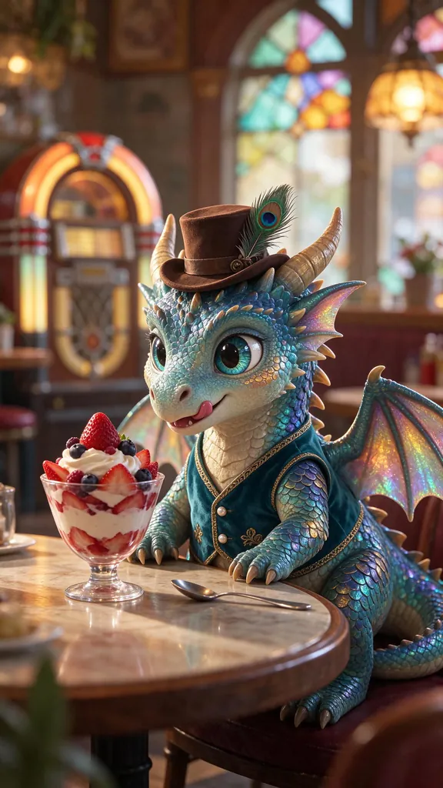

# Baby Dragon in a Waistcoat at a Café — by @JasonHeatony7

[← Back to Community Examples](../../EXAMPLES.md) · Category: Illustration & 3D · Model: `Seedream 5.5`

<a href="https://x.com/JasonHeatony7/status/2125609829150450164"></a>

Source: **[@JasonHeatony7 on X](https://x.com/JasonHeatony7/status/2125609829150450164)** · Creator: [Jason Heaton](https://x.com/JasonHeatony7)

## Prompt

```text
An adorable baby dragon with iridescent cyan, sapphire and golden scales, enormous expressive turquoise eyes, and translucent rainbow wings, dressed in a tailored velvet waistcoat in deep teal with embroidered gold trim and tiny pearl buttons. He wears a small brown felt top hat adorned with a vibrant peacock feather. Sitting at a polished marble-free wooden café table, he gazes hungrily at a towering strawberry and mixed-berry parfait, licking his lips in anticipation. A silver spoon rests on the table. A softly blurred vintage jukebox, stained-glass windows and warm amber lanterns illuminate the background. Whimsical photorealistic fantasy, cinematic lighting, exquisite textures, shallow depth of field, ultra-detailed 8K quality, uncluttered composition, no text, vertical 9:16.
```

## Try it

Paste the prompt into **[vinano.ai](https://vinano.ai?utm_source=github&utm_medium=readme&utm_campaign=awesome-image-video-prompts-updating&utm_content=x-page-try)** to generate your own version.

> The image and prompt belong to @JasonHeatony7 ([original post](https://x.com/JasonHeatony7/status/2125609829150450164)) and are shown here with credit for reference. Creators can ask for changes or removal by opening an issue.
