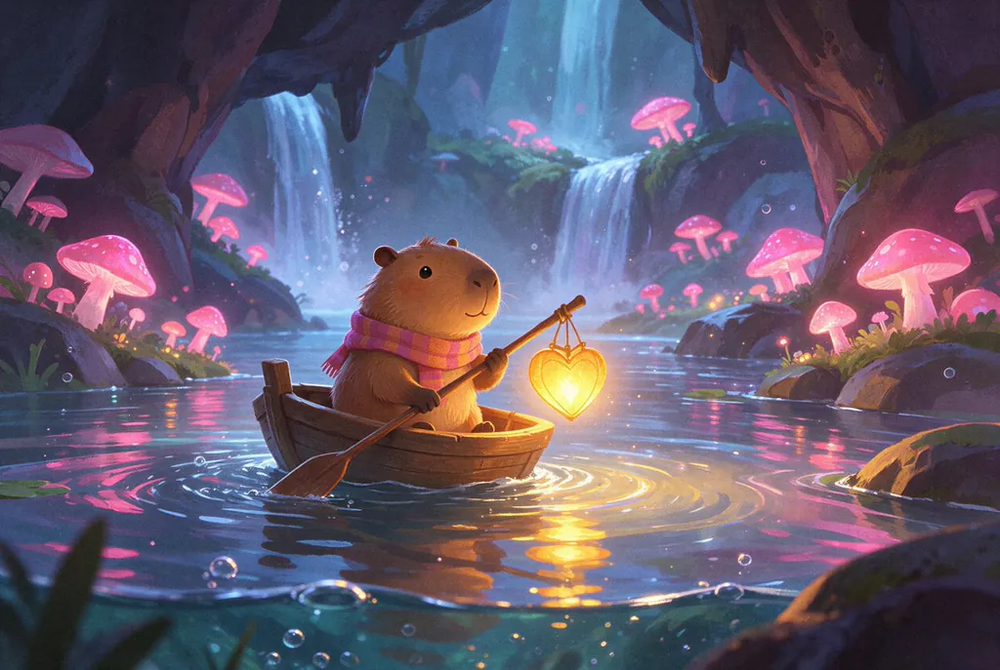

# Capybara Lantern Boat in a Glowing Cave — by @heathergreen

[← Back to Community Examples](../../EXAMPLES.md) · Category: Illustration & 3D · Model: `Seedream 5.5`

<a href="https://x.com/heathergreen/status/2125575233457226095"></a>

Source: **[@heathergreen on X](https://x.com/heathergreen/status/2125575233457226095)** · Creator: [Heather Green](https://x.com/heathergreen)

## Prompt

```text
A whimsical, high-detail fantasy illustration featuring a cute, anthropomorphic capybara-like creature, wearing a pink and orange striped scarf. The creature is sitting in a small, rustic wooden boat, paddling through a glowing subterranean cavern. It holds a wooden staff with a warm, golden, heart-shaped lantern hanging from the tip, casting a soft light on its face. The surrounding environment is a magical cave filled with bioluminescent pink mushrooms, sparkling water, and distant waterfalls. The lighting contrast is striking, with the warm golden glow of the lantern illuminating the creature against the cool, ethereal pink tones of the cave's magical atmosphere. The water surface shows ripples and reflections of the glowing elements.
```

## Try it

Paste the prompt into **[vinano.ai](https://vinano.ai?utm_source=github&utm_medium=readme&utm_campaign=awesome-image-video-prompts-updating&utm_content=x-page-try)** to generate your own version.

> The image and prompt belong to @heathergreen ([original post](https://x.com/heathergreen/status/2125575233457226095)) and are shown here with credit for reference. Creators can ask for changes or removal by opening an issue.
