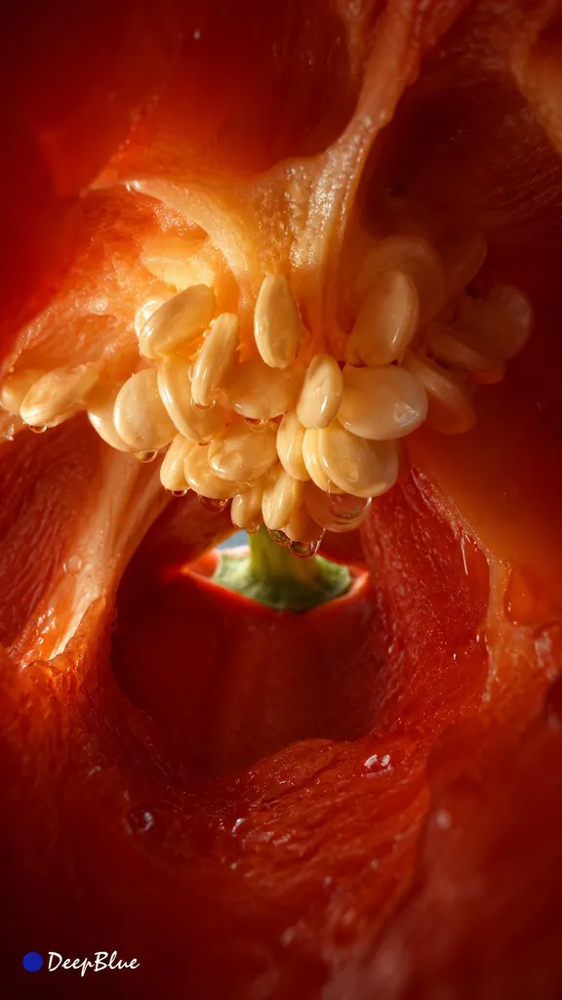

# Extreme Macro Visual Pun Series — by @DeepBlueX0

[← Back to Community Examples](../../EXAMPLES.md) · Category: Photography · Model: `GPT Image 2.6`

<a href="https://x.com/DeepBlueX0/status/2125720938847322209"></a>

Source: **[@DeepBlueX0 on X](https://x.com/DeepBlueX0/status/2125720938847322209)** · Creator: [DeepBlue深藍](https://x.com/DeepBlueX0)

## Prompt

```text
Extreme Macro Photography × 沉浸式微型視點 × 尺度錯覺 × 視覺雙關。

不同生活領域具有高度辨識度、趣味性、話題性或文化共鳴的物品，分別構思其最令人意外的微觀視覺意象。同組物品、視覺聯想與構圖各不相同，一件物品只生成一張。

將觀察視點縮小至物品的微觀尺度，自由探索其內部、表面與局部結構，利用真實形態、材質、色彩、空間關係及光學現象，發掘具有強烈視覺反差的雙重意象。

讓觀眾第一眼被奇異景象吸引，仔細觀察後發現熟悉物品的標誌性細節，產生意想不到的認知反轉。所有視覺錯覺源於物品自身的真實結構。

根據每件物品的獨特特徵，自由設計拍攝視點、構圖、色彩、光線與攝影技法，兼具視覺衝擊力、探索趣味與真實微觀攝影質感。

9:16直式獨立單圖，每張分別生成，不自動裁切。
左下深藍色實心圓點，後接白色自然手寫體「DeepBlue」。

n=9
```

## Try it

Paste the prompt into **[vinano.ai](https://vinano.ai?utm_source=github&utm_medium=readme&utm_campaign=awesome-image-video-prompts-updating&utm_content=x-page-try)** to generate your own version.

> The image and prompt belong to @DeepBlueX0 ([original post](https://x.com/DeepBlueX0/status/2125720938847322209)) and are shown here with credit for reference. Creators can ask for changes or removal by opening an issue.
