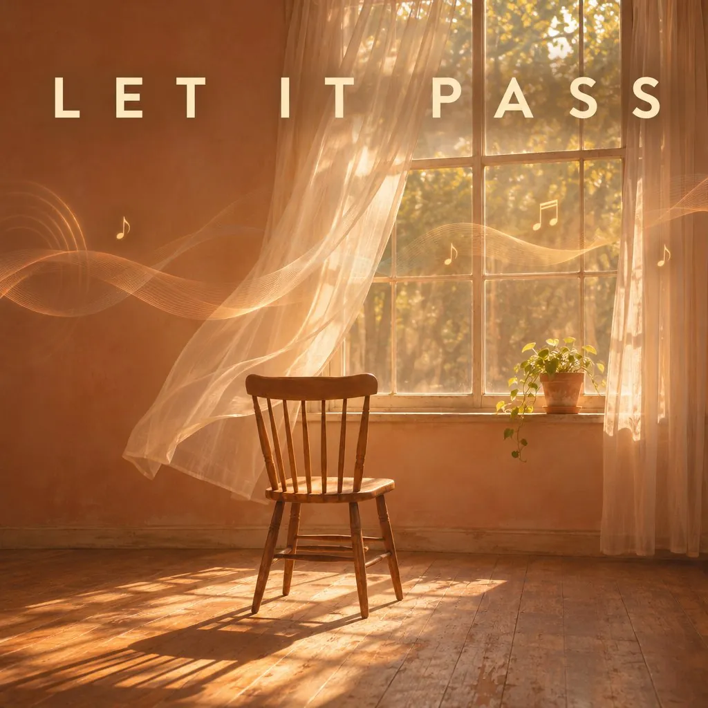

# Sunlit Chair Album Cover &quot;Let It Pass&quot; — by @DavidLi36143625

[← Back to Community Examples](../../EXAMPLES.md) · Category: Poster Design · Model: `GPT Image 2.6 Sunburst`

<a href="https://x.com/DavidLi36143625/status/2125535309999796460"></a>

Source: **[@DavidLi36143625 on X](https://x.com/DavidLi36143625/status/2125535309999796460)** · Creator: [David Liang](https://x.com/DavidLi36143625)

## Prompt

```text
Square album cover art. A single wooden chair in a sunlit room, facing a large window with sheer curtains billowing gently. Warm golden afternoon light floods in, casting soft shadows across a worn wooden floor. A small potted plant sits on the windowsill. Floating through the air are faint, translucent abstract shapes suggesting sound waves and musical notes, rendered as soft glowing curves and ripples of warm amber and gold, subtle enough to blend into the light. The song title "Let It Pass" in large, bold, spaced-out sans-serif type across the upper third of the image, in warm cream color. Palette: honey, terracotta, warm cream, soft amber. Inviting and calm, like a photograph taken for a record sleeve, not a snapshot. Generous negative space.
```

## Try it

Paste the prompt into **[vinano.ai](https://vinano.ai?utm_source=github&utm_medium=readme&utm_campaign=awesome-image-video-prompts-updating&utm_content=x-page-try)** to generate your own version.

> The image and prompt belong to @DavidLi36143625 ([original post](https://x.com/DavidLi36143625/status/2125535309999796460)) and are shown here with credit for reference. Creators can ask for changes or removal by opening an issue.
