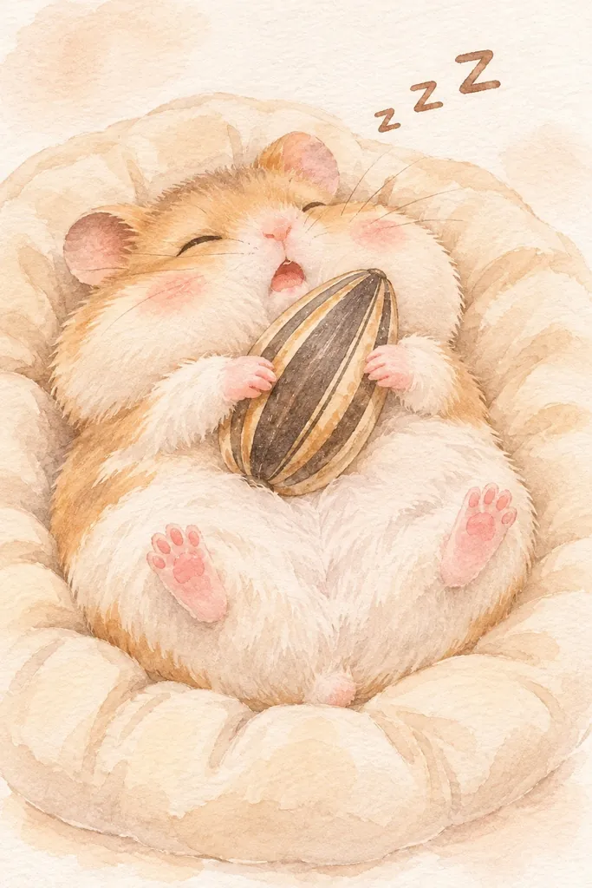

# Watercolor Picture Book: Hamster Asleep with a Snack — by @static_stare

[← Back to Community Examples](../../EXAMPLES.md) · Category: Illustration & 3D · Model: `GPT Image 2.5`

<a href="https://x.com/static_stare/status/2125449581110698375"></a>

Source: **[@static_stare on X](https://x.com/static_stare/status/2125449581110698375)** · Creator: [mo Ki](https://x.com/static_stare)

## Prompt

```text
Create an image with the following visual system. Replace the subject as specified.

Visual system (light, color, composition, medium, mood):
【画面风格】一张竖幅约 2:3 的手绘水彩绘本插画，像画在微微泛暖的白色冷压水彩纸上，颜料晕开的边、纸面细颗粒和留白都看得见，不是数字平涂，不是 3D，也不是照片。机位从正上方略偏一点往下看，近景，一只圆滚滚的小动物四仰八叉地仰躺在一个蓬松的大软垫上睡着了，占画面中间大半，软垫是奶油白和浅米色的布面，带一圈鼓鼓的边和几道柔软的褶，用淡淡的暖灰水彩扫出体积。小动物闭着眼、嘴巴微张像在打小呼噜，脸颊有两团淡淡的腮红，四只小爪子朝上张着，露出粉红色的小肉垫，肚皮是蓬松的白毛，身上的毛用一笔一笔细碎的水彩笔触带出毛尖，边缘有一点点干笔飞白。它两只前爪紧紧抱着一样小零食（零食由主体决定），零食是画面里颜色最饱和的地方。头顶旁边用暖棕色手写画三个由小到大的 z 字母表示在睡觉，这是画面里唯一的字。光是柔和的室内暖光，从左上方来，没有硬阴影，只在身体下面和软垫凹陷处有一层浅浅的暖棕色晕影。整体色调是奶油白、燕麦米、浅焦糖棕为主，腮红和肉垫的淡粉、零食的一小块亮色做点缀，饱和度偏低。背景是空的纸白，四周有几片很淡的米棕色水彩晕染。气氛软乎乎、安心，看着就想跟着睡。画面里除了那三个 z，不要别的文字、签名和水印。

New subject:
【主体】一只奶茶色和白色相间的小仓鼠，圆得像个小团子，仰躺着睡着了，两只小前爪抱着一颗比它脑袋还大的葵花籽，腮帮子鼓鼓的。
```

## Try it

Paste the prompt into **[vinano.ai](https://vinano.ai?utm_source=github&utm_medium=readme&utm_campaign=awesome-image-video-prompts-updating&utm_content=x-page-try)** to generate your own version.

> The image and prompt belong to @static_stare ([original post](https://x.com/static_stare/status/2125449581110698375)) and are shown here with credit for reference. Creators can ask for changes or removal by opening an issue.
