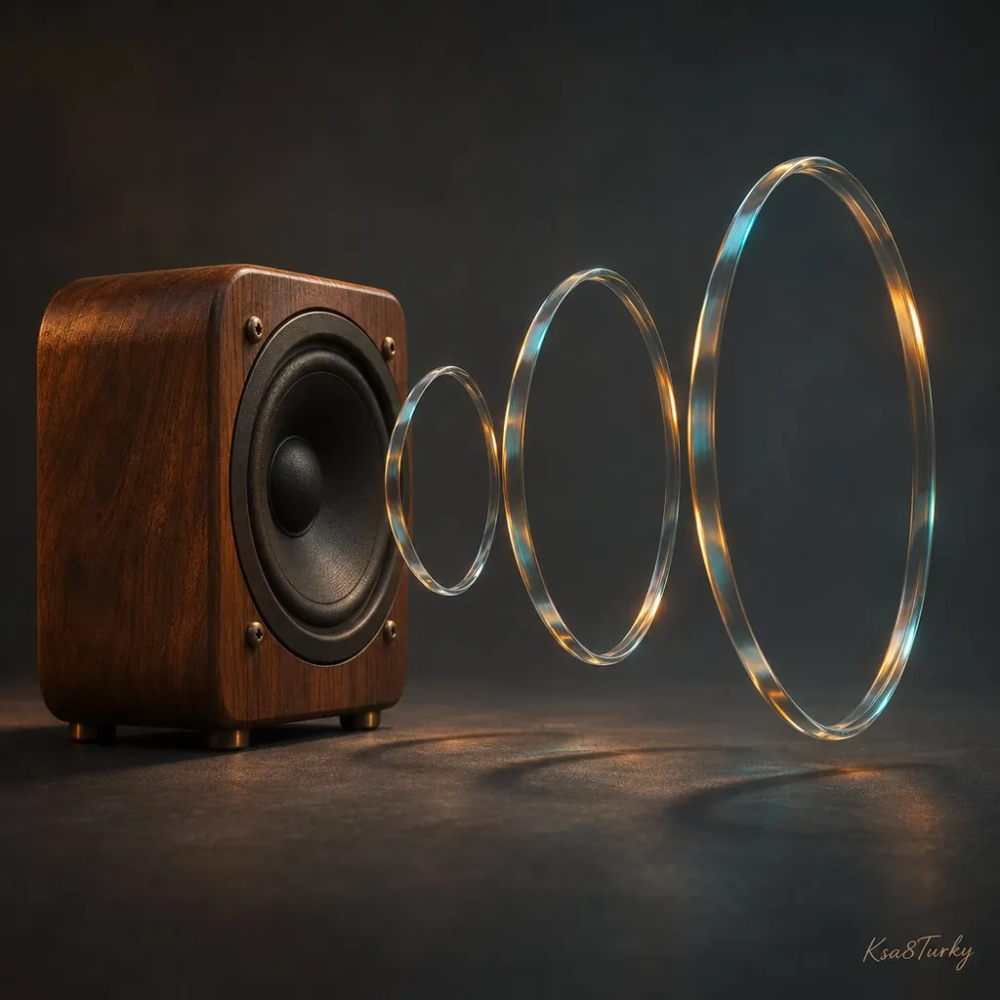

# Invisible Phenomenon as Physical Material — by @ksa8Turky

[← Back to Community Examples](../../EXAMPLES.md) · Category: Photography · Model: `GPT Image`

<a href="https://x.com/ksa8Turky/status/2125716911639924806"></a>

Source: **[@ksa8Turky on X](https://x.com/ksa8Turky/status/2125716911639924806)** · Creator: [‏Turky](https://x.com/ksa8Turky)

## Prompt

```text
Create a square premium surreal studio photograph visualizing [INVISIBLE PHENOMENON] as [PHYSICAL MATERIAL]. Example: one fictional walnut loudspeaker emitting three suspended clear-glass sound-wave rings, increasing in diameter away from its cone. Preserve coherent geometry, readable perspective and realistic source-object materials. Charcoal surface, amber/cyan rim light, delicate refraction and restrained composition. Keep all forms inside frame. No people, real product logos or headline. Small legible Ksa8Turky bottom right. Intentional impossible AI artwork.
```

## Try it

Paste the prompt into **[vinano.ai](https://vinano.ai?utm_source=github&utm_medium=readme&utm_campaign=awesome-image-video-prompts-updating&utm_content=x-page-try)** to generate your own version.

> The image and prompt belong to @ksa8Turky ([original post](https://x.com/ksa8Turky/status/2125716911639924806)) and are shown here with credit for reference. Creators can ask for changes or removal by opening an issue.
