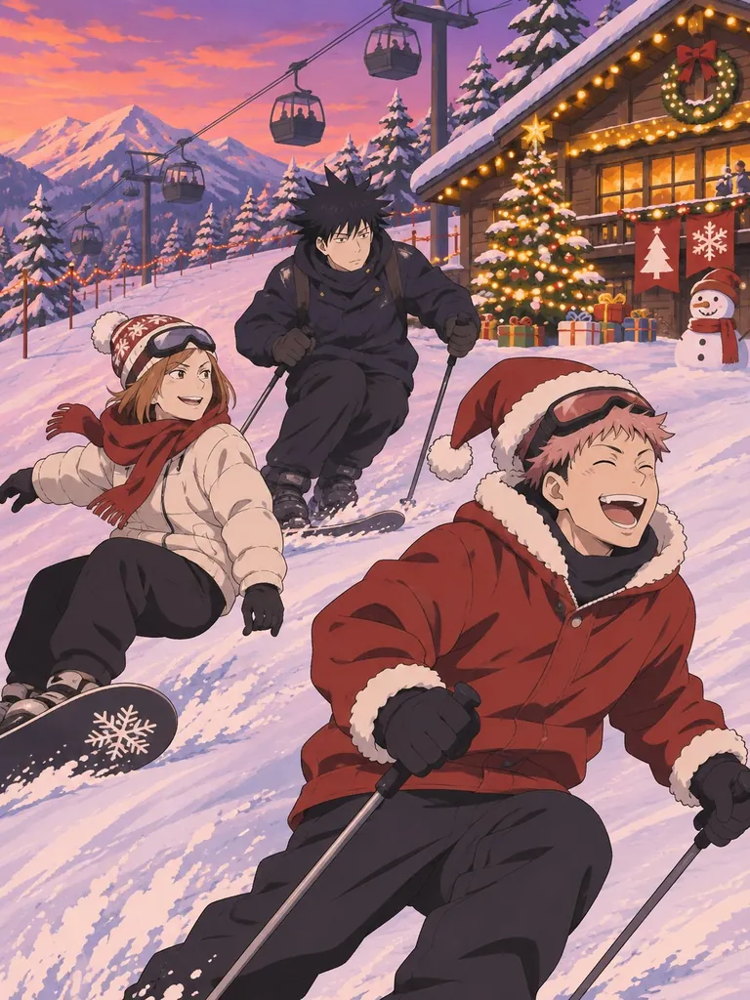

# Anime Friends on a Christmas Winter Vacation — by @MoescapeAi

[← Back to Community Examples](../../EXAMPLES.md) · Category: Illustration & 3D · Model: `Seedream 5.0`

<a href="https://x.com/MoescapeAi/status/2125683890270417056"></a>

Source: **[@MoescapeAi on X](https://x.com/MoescapeAi/status/2125683890270417056)** · Creator: [Moescape AI](https://x.com/MoescapeAi)

## Prompt

```text
Create a beautiful, lively anime illustration featuring a group of friends enjoying a magical Christmas winter vacation. Show them participating in a festive winter activity, such as relaxing together inside a beautifully decorated vintage train cabin, ice skating hand in hand, exploring a snowy Christmas market, enjoying an outdoor hot spring surrounded by snow, or having an energetic snowball fight. Dress everyone in cozy winter outfits, including oversized sweaters, padded jackets, scarves, gloves, beanies and warm boots, with outfits suited to each activity.

Art style: High-quality anime illustration, beautiful clean line art, expressive facial features, detailed eyes, soft cel shading, rich but balanced colors, delicate fabric textures, warm skin tones and polished anime aesthetics.

Use a vertical 3:4 anime composition with an immersive cinematic perspective. Capture natural candid moments, playful interactions, genuine smiles and spontaneous expressions. Arrange the characters naturally, with interesting poses and varied body language. Include foreground elements such as snow-covered objects, festive decorations, mugs of hot chocolate, Christmas presents, skating blades or snowballs to create depth.

Create a highly detailed winter wonderland background with snow-covered mountains, charming wooden cabins, glowing Christmas trees, festive market stalls, warm lanterns, sparkling fairy lights, decorated windows and gentle snowfall. Include a beautiful pink-purple winter sunset contrasting with the warm golden Christmas lights.

Make the environment feel alive, cozy and full of holiday excitement. Use cinematic lighting, soft atmospheric shadows, beautiful reflections, subtle snow particles and intricate environmental details. The overall atmosphere should capture friendship, warmth, adventure and the magic of spending Christmas together.

Aspect ratio: Vertical 3:4.
```

## Try it

Paste the prompt into **[vinano.ai](https://vinano.ai?utm_source=github&utm_medium=readme&utm_campaign=awesome-image-video-prompts-updating&utm_content=x-page-try)** to generate your own version.

> The image and prompt belong to @MoescapeAi ([original post](https://x.com/MoescapeAi/status/2125683890270417056)) and are shown here with credit for reference. Creators can ask for changes or removal by opening an issue.
