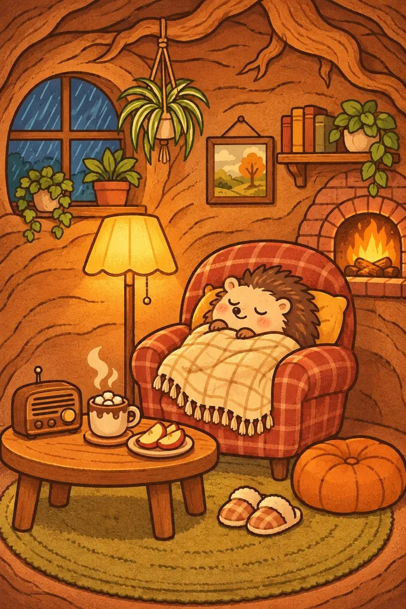

# Rainy-Day Burrow Home Cartoon — by @static_stare

[← Back to Community Examples](../../EXAMPLES.md) · Category: Illustration & 3D · Model: `GPT Image 2.5`

<a href="https://x.com/static_stare/status/2125494094453715091"></a>

Source: **[@static_stare on X](https://x.com/static_stare/status/2125494094453715091)** · Creator: [mo Ki](https://x.com/static_stare)

## Prompt

```text
Create an image with the following visual system. Replace the subject as specified.

Visual system (light, color, composition, medium, mood):
【画面风格】一张竖幅约 2:3 的暖色卡通插画，粗细均匀的深棕色描边，平涂上色再叠一点颗粒笔刷的明暗，像一页温暖的儿童绘本，不是 3D，不是写实。画面是一间挖在土里的小洞屋的室内，四周墙壁是弧形的土洞壁，用几道深棕色弯线画出土层的纹路，从画面边缘包过来像一个圆框。左上方墙上开着一扇圆拱形的小窗，窗外是深蓝色的雨天，斜斜的浅蓝雨丝，窗台上摆两盆绿植，窗边垂下一盆吊兰。屋里有一盏亮着的落地台灯，暖黄的灯光把周围照亮，右边有个砖砌小壁炉里火苗在烧，墙上挂一幅小画，搁板上立着几本书和一盆小绿植。画面中间偏右是主角：一只小动物裹着奶油色的流苏毯子窝在一张软软的扶手椅里，闭着眼睛、嘴角带笑，脸颊有粉色腮红，舒服得快睡着了。前景是一张圆角木茶几，上面放着冒热气的杯子和一点小吃，地上铺一块圆形的橄榄绿地毯，旁边一个圆圆的橙色坐垫和一双小拖鞋。整体色调是赭石、焦糖、南瓜橙、芥末黄这些暖色，窗外的深蓝和绿植的绿是唯一的冷色对比。光是室内暖光，灯和壁炉两个光源，阴影是更深的暖棕。氛围是下雨天下午哪儿也不去、窝着就很满足。画面里不要任何文字和水印。

New subject:
【主体】一只圆滚滚的小刺猬窝在一张红色格纹扶手椅里，裹着奶油色毯子，背上的刺从毯子里冒出来；屋子挖在一棵老树的树根下面，天花板上能看到几根粗粗的树根；茶几上是一杯热可可和一碟苹果片，旁边一台老式小收音机代替电视。
```

## Try it

Paste the prompt into **[vinano.ai](https://vinano.ai?utm_source=github&utm_medium=readme&utm_campaign=awesome-image-video-prompts-updating&utm_content=x-page-try)** to generate your own version.

> The image and prompt belong to @static_stare ([original post](https://x.com/static_stare/status/2125494094453715091)) and are shown here with credit for reference. Creators can ask for changes or removal by opening an issue.
