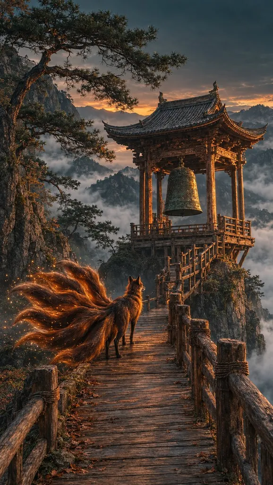

# Cliffside Bell Tower and Nine-Tailed Fox at Dusk — by @Andy4aicreate

[← Back to Community Examples](../../EXAMPLES.md) · Category: Photography · Model: `GPT Image 2.6 Flare`

<a href="https://x.com/Andy4aicreate/status/2125716497225896211"></a>

Source: **[@Andy4aicreate on X](https://x.com/Andy4aicreate/status/2125716497225896211)** · Creator: [Andy](https://x.com/Andy4aicreate)

## Prompt

```text
一张九比十六竖版东方仙境题材电影感奇幻摄影。画面主体是一座悬于山崖之间、以原木栈道相连的钟楼，钟楼飞檐轻翘，悬挂着一枚无文字的青铜钟，钟身爬满细小苔痕。栈道从崖壁延伸至钟楼脚下，木质扶手历经风雨，纹理清晰可辨。

钟楼后方是层叠的深色山峦与缭绕云雾，云海在山谷间缓缓流动，露出远处若隐若现的第二重山脊。崇山之间点缀着几株遒劲的老松，枝干向钟楼一侧倾斜，针叶在晚风中微微颤动。

栈道中段立着一只完全虚构的九尾狐，毛色为深琥珀与墨黑的渐变，九条尾巴如烈焰般向后舒展，尾尖缀着细小的萤火虫群，光点在暮色中忽明忽暗。狐狸侧身回望钟楼，姿态安静警觉，四足稳稳踏在栈道木板上，不悬空、不变形。

天色为深秋暮色，太阳已沉入云海之下，只留下一道琥珀色余晖贴着山脊线，余晖之上是渐暗的墨绿与藏青夜色。钟楼与栈道受余晖染成温暖的赭金色，山体与云雾则保持清冷的墨绿与灰蓝，形成一冷一暖的清晰对比。

电影级风光摄影质感，材质细腻真实，光影自然柔和，画面疏密有致，云雾、山峦、钟楼与狐狸各自保留清晰层次，不拼贴、不透叠。画面中不加任何文字、签名、印章或水印。
```

## Try it

Paste the prompt into **[vinano.ai](https://vinano.ai?utm_source=github&utm_medium=readme&utm_campaign=awesome-image-video-prompts-updating&utm_content=x-page-try)** to generate your own version.

> The image and prompt belong to @Andy4aicreate ([original post](https://x.com/Andy4aicreate/status/2125716497225896211)) and are shown here with credit for reference. Creators can ask for changes or removal by opening an issue.
