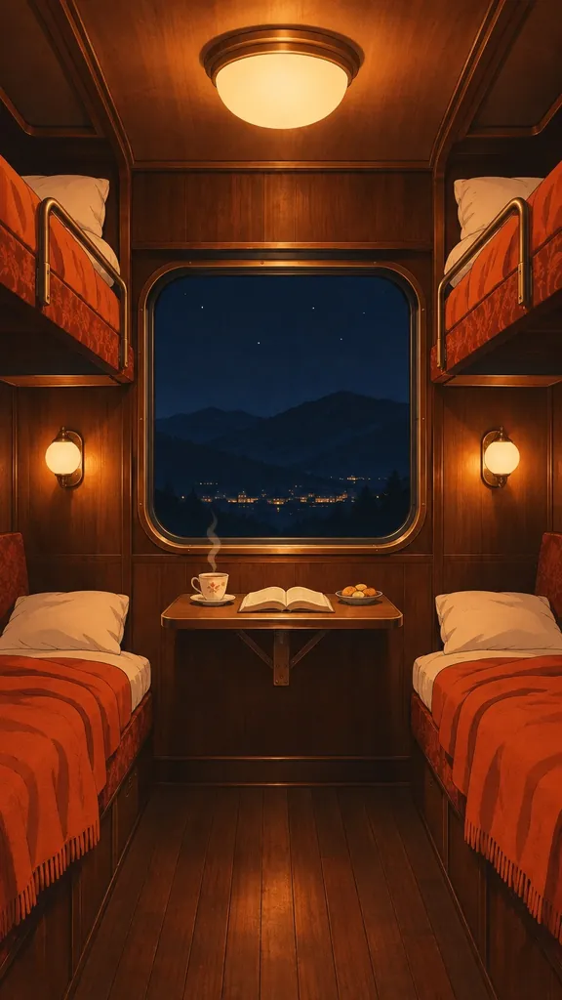

# Retro Anime Night Train Sleeper Cabin — by @static_stare

[← Back to Community Examples](../../EXAMPLES.md) · Category: Illustration & 3D · Model: `GPT Image 2.5`

<a href="https://x.com/static_stare/status/2125591906835185851"></a>

Source: **[@static_stare on X](https://x.com/static_stare/status/2125591906835185851)** · Creator: [mo Ki](https://x.com/static_stare)

## Prompt

```text
Create an image with the following visual system. Replace the subject as specified.

Visual system (light, color, composition, medium, mood):
【画面风格】一张竖幅约 9:16 的复古日系动画夜景插画，手绘感的数字绘画，线条利落、色块平整，带一点点胶片颗粒，不是 3D，不是照片。画面是一个空无一人的小交通工具车厢内部（具体是什么由主体决定），一点透视、左右基本对称，正对着车厢尽头一扇圆角的大窗。车厢内饰是深色胡桃木的墙板和地板，天花板正中一盏圆形乳白灯罩的顶灯，两侧墙上各有一盏球形小壁灯，全都亮着暖琥珀色的光，在木头上留下柔和的光晕。窗外是深沉的午夜蓝，看得见远处的山或水的轮廓线，和一串细小的暖黄灯点，天上有几颗星，窗外不下雨。窗前是一张小圆桌，桌上一杯热饮冒着一缕细细的白汽，旁边一本摊开的书和一小碟零食。座椅是橙红色带暗纹的软垫，被灯照得发暖。整体是暖琥珀、橙红、深木棕和窗外午夜蓝的强烈冷暖对比，暗部是很深的棕黑色。气氛很安静，夜里只剩这一处亮着，适合一个人坐着发呆。画面里不要人物、文字、标识和水印。

New subject:
【主体】一节夜行列车的双层卧铺包厢：左右两侧是上下铺，铺着橙红色毯子和白枕头，下铺之间是固定在窗下的小折叠桌，桌上放着冒热气的茶和一本书；窗外是远处山脚下的小镇灯火。
```

## Try it

Paste the prompt into **[vinano.ai](https://vinano.ai?utm_source=github&utm_medium=readme&utm_campaign=awesome-image-video-prompts-updating&utm_content=x-page-try)** to generate your own version.

> The image and prompt belong to @static_stare ([original post](https://x.com/static_stare/status/2125591906835185851)) and are shown here with credit for reference. Creators can ask for changes or removal by opening an issue.
