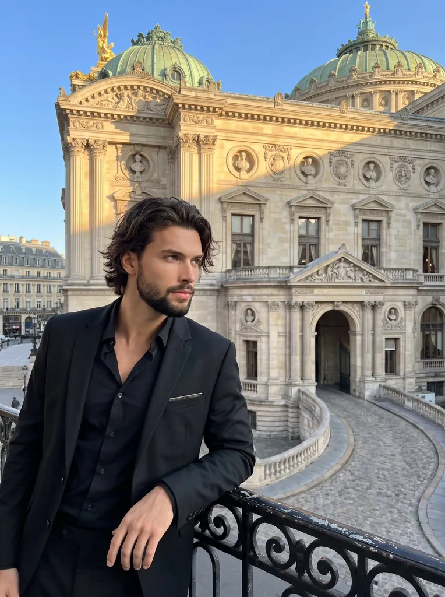

# Parisian Menswear Editorial Portrait — by @pictsbyai

[← Back to Community Examples](../../EXAMPLES.md) · Category: Photography · Model: `Nano Banana 2.1`

<a href="https://x.com/pictsbyai/status/2125504261144625452"></a>

Source: **[@pictsbyai on X](https://x.com/pictsbyai/status/2125504261144625452)** · Creator: [Picts by AI](https://x.com/pictsbyai)

## Prompt

```text
Positioned in the lower-left foreground using the rule of thirds, a young handsome man with terracotta-toned skin (#B77F64) wears a jet-black (#0E0F12) open-collar shirt and blazer featuring a subtle metallic pocket detail. His medium-length dark brown wavy hair reaches his mid-neck and upper ears, styled in a loose, pushed-back curtain cut with an off-center part, natural root volume, a semi-matte finish, and windswept flyaways. Projecting a posed, confident expression, he turns his head in three-quarter profile to the right with neutral straight eyebrows, relaxed closed lips, and a calm gaze directed rightward. Angled at 45 degrees with his right shoulder tilted lower and forward, he leans his weight onto his right forearm, draping his relaxed right hand and loosely curved fingers over an aged black wrought-iron balcony railing with ornate scrollwork and minor paint chips along the top rail. Set on a Parisian rooftop terrace overlooking the Palais Garnier and a distant Haussmannian roof on the far left, the midground features the vintage Emperor's Pavilion with a stone balustrade, arched entryway, sculptural pediment, and a curved carriage ramp paved in warm gray-brown cobblestone. Rising in the background in two-point perspective, the grand Beaux-Arts facade is built from matte, rough-textured dressed ashlar limestone masonry carved with Corinthian pilasters, circular stone medallions with busts, arched casement windows, garlands, and dentil cornices, crowned by oxidized verdigris patina green (#7D9B84) ribbed copper domes and gilded apex statues. Directional low-angle golden hour sunlight from the left bathes the right side of the masonry in sunlit golden limestone (#DEC293) and warm cream while casting a long, harsh diagonal gray shadow across the left facade that turns the stone cool taupe-gray. Open sky ambient fill softens the gradual shadows on the right side of the subject's face while a warm rim light catches his left cheekbone and temple, creating a high-contrast, moderately saturated complementary palette against the clear sky blue (#5D92CC). Captured as a tack-sharp digital photograph from a slightly low angle with a 26mm-28mm focal length at f/2.8 to f/4, ISO 64, and 1/1000s shutter speed, this Parisian luxury menswear editorial portrait uses natural smartphone HDR processing to preserve highlights and dark suit details across a deep depth of field, framed in a 3:4 vertical aspect ratio.
```

## Try it

Paste the prompt into **[vinano.ai](https://vinano.ai?utm_source=github&utm_medium=readme&utm_campaign=awesome-image-video-prompts-updating&utm_content=x-page-try)** to generate your own version.

> The image and prompt belong to @pictsbyai ([original post](https://x.com/pictsbyai/status/2125504261144625452)) and are shown here with credit for reference. Creators can ask for changes or removal by opening an issue.
