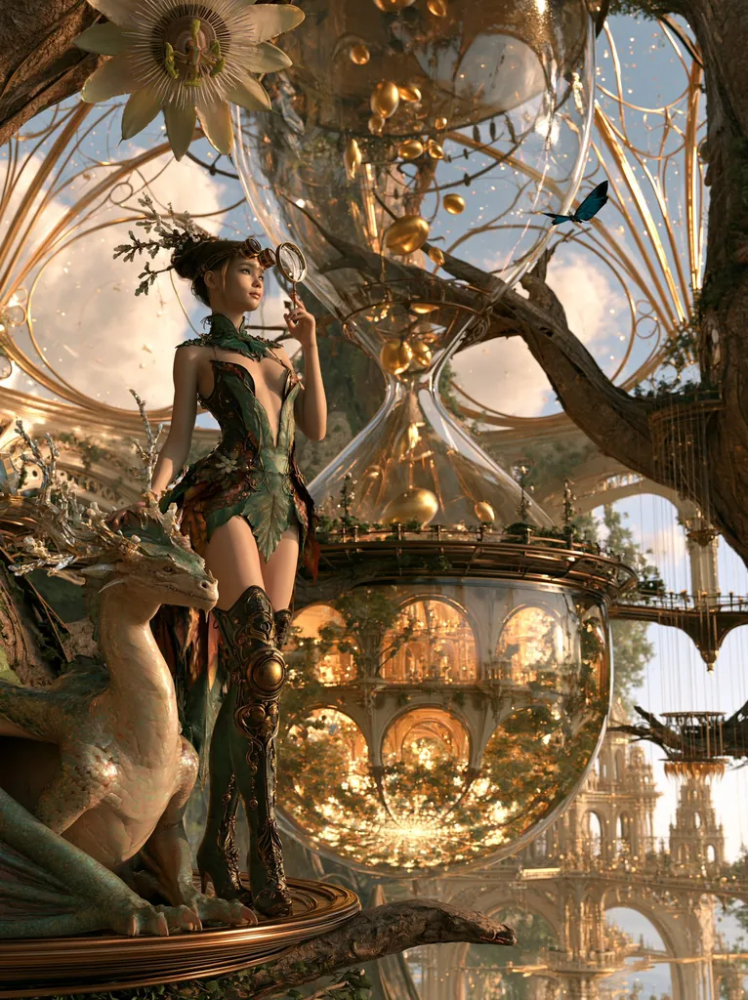

# Art Nouveau Steampunk Biologist and Opal Dragon — by @SethCritchley

[← Back to Community Examples](../../EXAMPLES.md) · Category: Illustration & 3D · Model: `Midjourney`

<a href="https://x.com/SethCritchley/status/2125582394224976258"></a>

Source: **[@SethCritchley on X](https://x.com/SethCritchley/status/2125582394224976258)** · Creator: [Super Producer Seth](https://x.com/SethCritchley)

## Prompt

```text
Ultra-photorealistic Art Nouveau steampunk fantasy, full-body cinematic composition. Beautiful biologist in black-cherry and celadon botanical couture, brass-accented knee-high boots and quartz magnifier headband, beside a wingless opal dragon with branching crystal horns. Both stand on a branch terrace encircling an immense transparent hourglass-shaped fruit suspended from the colossal Tree of Life. Golden seeds above, luminous fractal miniature civilization below, recursive gardens, palatial arches and suspended bridges. Ivory passionflower with a single blue Papilio butterfly overhead. Celestial crystal vaults, golden astronomical ribs, pearl clouds, champagne sky, warm amber illumination, exquisite opalescent refractions, intricate organic architecture, deep focus, natural skin textures, 8K, Octane render --ar 3:4 --style raw
```

## Try it

Paste the prompt into **[vinano.ai](https://vinano.ai?utm_source=github&utm_medium=readme&utm_campaign=awesome-image-video-prompts-updating&utm_content=x-page-try)** to generate your own version.

> The image and prompt belong to @SethCritchley ([original post](https://x.com/SethCritchley/status/2125582394224976258)) and are shown here with credit for reference. Creators can ask for changes or removal by opening an issue.
