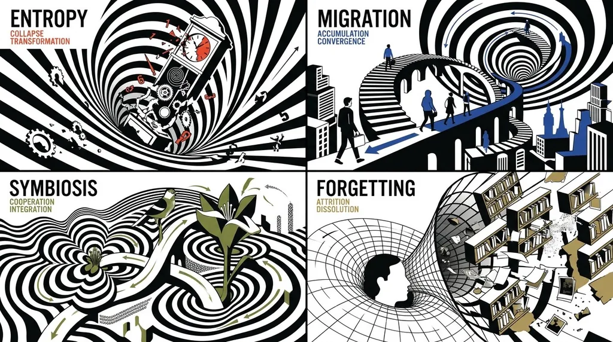

# Kinetic Vortex Infographics 2x2 Grid — by @Gdgtify

[← Back to Community Examples](../../EXAMPLES.md) · Category: UI & Graphic · Model: `Nano Banana 2.1`

<a href="https://x.com/Gdgtify/status/2125519615304274301"></a>

Source: **[@Gdgtify on X](https://x.com/Gdgtify/status/2125519615304274301)** · Creator: [Gadgetify](https://x.com/Gdgtify)

## Prompt

```text
2x2 grid, 16:9, AI picks topics: 
TOPIC = $ input  # Change only this line.

class Kinetic_Vortex_Infographics:

    def __init__(self, topic):
        self.topic = topic

        self.identity = AI_INFER(
            topic,
            identify="""
            The strongest recognizable visual cues
            or subject-specific symbolic relationships.

            Preserve an identifiable primary subject
            even after extreme geometric abstraction.
            """
        )

        self.motion = AI_INFER(
            topic,
            invent="""
            The strongest visual movement concept
            associated with this particular topic.

            Possibilities include expansion, collapse,
            rotation, acceleration, accumulation,
            conflict, transformation, repetition,
            convergence, or an abstract journey.

            Infer what movement makes conceptual sense.

            Do not automatically portray every
            topic as economic growth or progress.
            """
        )

        self. world = AI_INFER(
            topic,
            construct="""
            An impossible architectural environment
            expressing the topic through monumental
            geometric structures and optical illusions.

            Translate subject-related forms into
            curved staircases, spiraling passages,
            warped planes, or dynamic trajectories.

            Avoid generic unrelated architecture.
            """
        )

    def render(self):
        return generate_images(
            count=4,
            aspect_ratio="4:5",
            output="four separate finished artworks",

            art_direction=f"""
            Transform {self.topic} into an extraordinary
            kinetic editorial infographic.

            Combine 1960s optical art, impossible
            geometric architecture, minimalist
            flat-vector storytelling, and modern
            conceptual information design.

            Make graphic lines appear to bend
            space, pull perspective, and transform
            architecture into visual movement.

            Subject identity: {self.identity}
            Motion concept: {self.motion}
            Architectural world: {self. world}

            The image must feel hypnotic,
            intelligent, monumental, and dynamic.
            """,

            optical_geometry="""
            DOMINANT STYLE RULE:

            Build the composition around massive
            black-and-white optical geometry.

            Use:
            - Converging radial stripes
            - Hypnotic spiral tunnels
            - Warped concentric rings
            - Curved parallel bands
            - Distorted perspective grids
            - Undulating striped landscapes
            - Dramatic funnel-shaped voids
            - Alternating black and white surfaces

            Control stripe width to create
            a convincing illusion of spatial depth.

            Let different stripe systems merge
            into architectural features.

            Create a single primary visual vortex,
            with secondary distortions only where useful.

            Preserve strong graphic readability.
            """,

            impossible_architecture="""
            Construct an elegant architectural
            structure from the optical geometry.

            Choose subject-appropriate elements:
            - Monumental ascending stairways
            - Curved bridges
            - Floating platforms
            - Distorted building silhouettes
            - Impossible pathways
            - Sculptural ramps
            - Geometric corridors
            - Warped chart-like structures

            Integrate them physically into
            the swirling black-and-white space.

            Staircases should emerge from curves.

            Graph-like structures may become
            buildings or impossible landscapes.

            Avoid separate floating chart widgets.

            The environment itself must tell
            the subject's conceptual story.
            """,

            hero_subject="""
            Give the topic a clear visual anchor.

            For people:
            Use bold recognizable graphic profiles,
            simplified clothing, expressive poses,
            and distinctive silhouette features.

            For animals:
            Preserve defining anatomical geometry
            using flat illustrative forms.

            For objects:
            Transform recognizable components into
            large graphic architectural shapes.

            For places:
            Incorporate landmark silhouettes
            into the impossible environment.

            For abstract concepts:
            Invent a central symbol or narrative
            metaphor integrated into the vortex.

            Keep the subject recognizable.

            Do not add generic businessmen,
            astronauts, or cartoon figures
            unless relevant to the topic.
            """,

            infographic_language="""
            Integrate the sophistication of
            an editorial information graphic.

            Introduce:
            - Thin directional arrows
            - Minimal trajectory lines
            - Geometric data-like markers
            - Small vector pictograms
            - Repeated stepped structures
            - Elegant proportional divisions
            - Abstract growth or change curves
            - Small subject-related visual symbols

            Use these elements as compositional tools.

            Do not imply quantitative facts
            that have not been supplied.

            Avoid unnecessary numerical labels.

            Make information design expressive
            without becoming a dashboard.
            """,

            color_system="""
            PRIMARY:
            Pure black         #050505
            Warm white         # F8F6EF

            RESERVED ACCENTS:
            Vermilion red      # C93D2A
            Deep cobalt        # 164B85
            Olive green        # 606B3F
            Muted gold         # E0AD62

            Approximately 70% of the composition's
            visual impact comes from black and white.

            Use one dominant accent color per artwork.

            Introduce a second accent only
            when compositionally necessary.

            Color should identify the subject
            or key narrative elements.

            Use large flat color masses.

            No gradients, glow, or glossy rendering.
            """,

            spatial_composition="""
            Create a dramatic vertical poster.

            Give the composition a powerful
            visual entry point near the foreground.

            Direct the viewer toward an optical
            vanishing point or impossible destination.

            Use aggressive foreground-to-background
            scale changes.

            Allow a large subject or graphic form
            to partially interrupt the striped space.

            Balance hypnotic background complexity
            with clean foreground silhouette shapes.

            Prefer one monumental integrated scene
            over a standard four-panel layout.

            Every major component must participate
            in the same impossible visual world.
            """,

            rendering="""
            Precision flat-vector illustration.

            Hard-edged black-and-white shapes.

            Smooth mathematical curves.

            Sharp color separation.

            Minimal contour lines on colored subjects.

            Slightly retro editorial poster character.

            No photographic texture.

            No airbrushing.

            No soft realistic shadows.

            No conventional 3D render.

            All depth must emerge from perspective,
            optical geometry, occlusion, and scale.
            """,

            controlled_variation="""
            Generate four genuinely distinct compositions.

            Preserve optical geometry, impossible
            architecture, black-and-white dominance,
            selective spot color, and minimal illustration.

            Change:
            - Spiral direction and topology
            - Architectural arrangement
            - Narrative viewpoint
            - Subject placement
            - Main movement concept
            - Accent-color placement

            Do not simply rotate or recolor
            the same optical illusion.
            """,

            final_check="""
            The subject must remain recognizable.

            Optical geometry must dominate
            the artistic identity.

            Architecture and diagram structures
            must feel physically integrated
            into the striped vortex.

            The space must be visually impossible
            yet compositionally believable.

            Color must remain selective.

            Avoid conventional business infographics.

            Avoid an optical background with
            an unrelated subject pasted over it.

            All four outputs should be distinctive.
            """
        )

Kinetic_Vortex_Infographics(TOPIC).render()
```

## Try it

Paste the prompt into **[vinano.ai](https://vinano.ai?utm_source=github&utm_medium=readme&utm_campaign=awesome-image-video-prompts-updating&utm_content=x-page-try)** to generate your own version.

> The image and prompt belong to @Gdgtify ([original post](https://x.com/Gdgtify/status/2125519615304274301)) and are shown here with credit for reference. Creators can ask for changes or removal by opening an issue.
