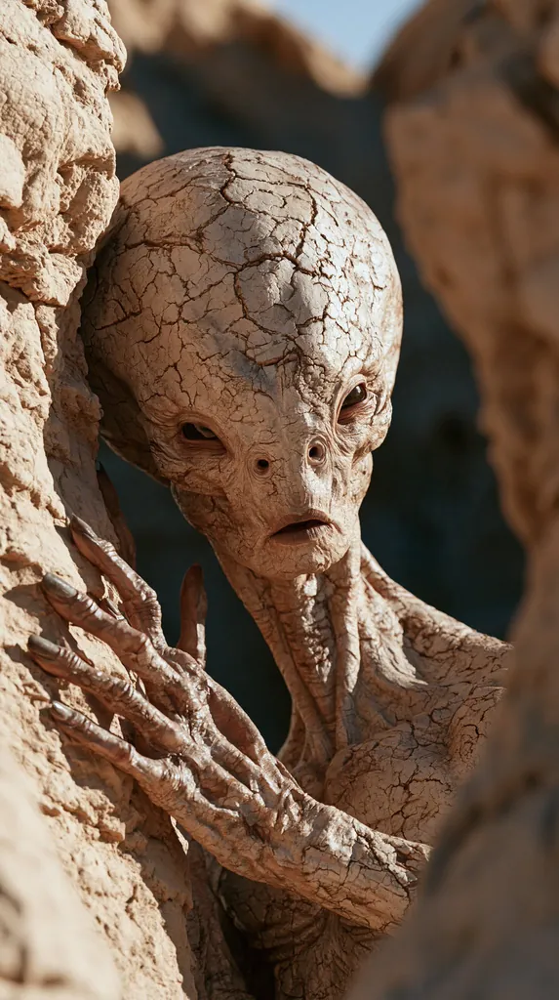

# Documentary Photo of a Desert Alien Humanoid — by @92digitalartArt

[← Back to Community Examples](../../EXAMPLES.md) · Category: Photography · Model: `Midjourney`

<a href="https://x.com/92digitalartArt/status/2125518456908812611"></a>

Source: **[@92digitalartArt on X](https://x.com/92digitalartArt/status/2125518456908812611)** · Creator: [Easy A.I.](https://x.com/92digitalartArt)

## Prompt

```text
[A slender alien humanoid with cracked sandstone-colored skin, four small recessed eyes, elongated fingers and an unusually narrow skull, standing between enormous desert rock formations] ultra-photorealistic documentary photography, Sony A1, cold diffused daylight, muted organic colors, physically accurate shadows, realistic biological anatomy, intricate skin microtextures, natural optical depth, authentic photographic realism, no CGI, no illustration, no text --v 8.2
```

## Try it

Paste the prompt into **[vinano.ai](https://vinano.ai?utm_source=github&utm_medium=readme&utm_campaign=awesome-image-video-prompts-updating&utm_content=x-page-try)** to generate your own version.

> The image and prompt belong to @92digitalartArt ([original post](https://x.com/92digitalartArt/status/2125518456908812611)) and are shown here with credit for reference. Creators can ask for changes or removal by opening an issue.
