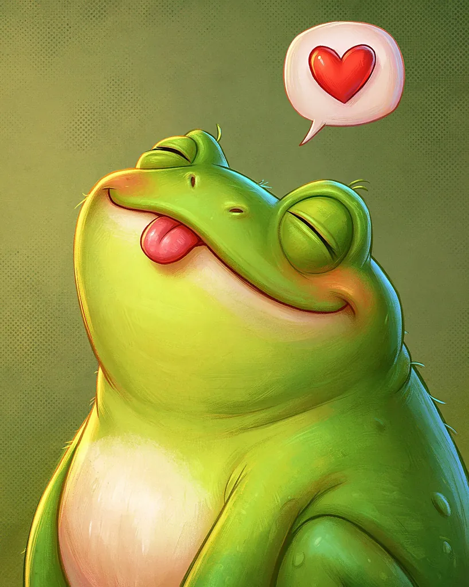

# Happy Frog with a Heart Speech Bubble — by @heathergreen

[← Back to Community Examples](../../EXAMPLES.md) · Category: Illustration & 3D · Model: `Midjourney`

<a href="https://x.com/heathergreen/status/2124986851488301412"></a>

Source: **[@heathergreen on X](https://x.com/heathergreen/status/2124986851488301412)** · Creator: [Heather Green](https://x.com/heathergreen)

## Prompt

```text
A digital illustration in a whimsical, cartoon style featuring a cute, chubby green frog with a light-colored belly. The frog has a happy expression with its eyes closed and its tongue sticking out. Above the frog's head is a speech bubble containing a small red heart. The background is a muted olive green with a subtle halftone dot texture. The art style uses clean, bold outlines and soft, flat coloring. --ar 4:5 --raw --sref 1491902504 1792387994 --stylize 300 --hd
```

## Try it

Paste the prompt into **[vinano.ai](https://vinano.ai?utm_source=github&utm_medium=readme&utm_campaign=awesome-image-video-prompts-updating&utm_content=x-page-try)** to generate your own version.

> The image and prompt belong to @heathergreen ([original post](https://x.com/heathergreen/status/2124986851488301412)) and are shown here with credit for reference. Creators can ask for changes or removal by opening an issue.
