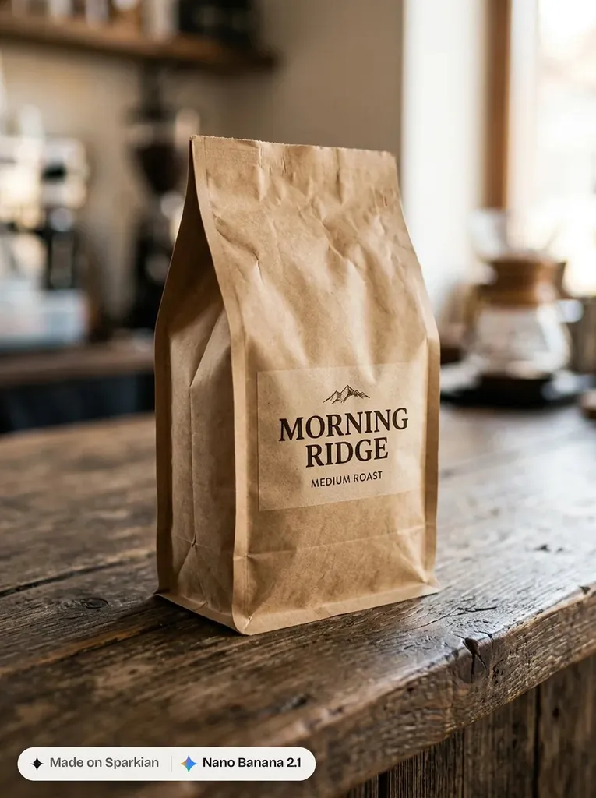

# Kraft-Paper Coffee Bag Label — by @SparkianAI

[← Back to Community Examples](../../EXAMPLES.md) · Category: Product & Brand · Model: `Nano Banana 2.1`

<a href="https://x.com/SparkianAI/status/2125635626339045853"></a>

Source: **[@SparkianAI on X](https://x.com/SparkianAI/status/2125635626339045853)** · Creator: [Sparkian](https://x.com/SparkianAI)

## Prompt

```text
A kraft-paper coffee bag standing on a wooden counter, its front label reading "MORNING RIDGE" in a bold serif with "MEDIUM ROAST" beneath. Realistic paper creases, soft side light, no other text.
```

## Try it

Paste the prompt into **[vinano.ai](https://vinano.ai?utm_source=github&utm_medium=readme&utm_campaign=awesome-image-video-prompts-updating&utm_content=x-page-try)** to generate your own version.

> The image and prompt belong to @SparkianAI ([original post](https://x.com/SparkianAI/status/2125635626339045853)) and are shown here with credit for reference. Creators can ask for changes or removal by opening an issue.
