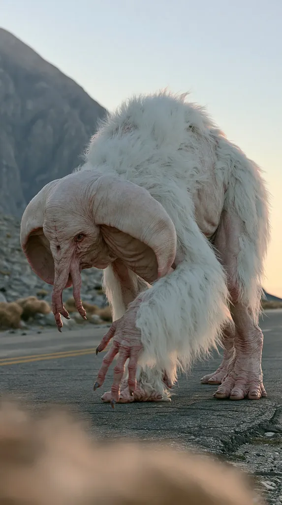

# Cryptid on a Mountain Road, Hidden-Camera Style — by @92digitalartArt

[← Back to Community Examples](../../EXAMPLES.md) · Category: Photography · Model: `Midjourney`

<a href="https://x.com/92digitalartArt/status/2125541348572803458"></a>

Source: **[@92digitalartArt on X](https://x.com/92digitalartArt/status/2125541348572803458)** · Creator: [Easy A.I.](https://x.com/92digitalartArt)

## Prompt

```text
A disturbing two-meter-tall bipedal creature with sparse white fur, wrinkled pinkish skin, unusually long fingers, enormous folded ears and a hunched posture, walking across a deserted mountain road at dawn. Secretly captured smartphone photograph from a concealed position, blurred foreground obstruction, subtle camera shake, imperfect autofocus, natural ambient lighting, realistic biological microtextures, physically accurate shadows, full-body view, entire creature visible, raw unedited image, no CGI, no illustration, no humans, no text--v 8.2
```

## Try it

Paste the prompt into **[vinano.ai](https://vinano.ai?utm_source=github&utm_medium=readme&utm_campaign=awesome-image-video-prompts-updating&utm_content=x-page-try)** to generate your own version.

> The image and prompt belong to @92digitalartArt ([original post](https://x.com/92digitalartArt/status/2125541348572803458)) and are shown here with credit for reference. Creators can ask for changes or removal by opening an issue.
