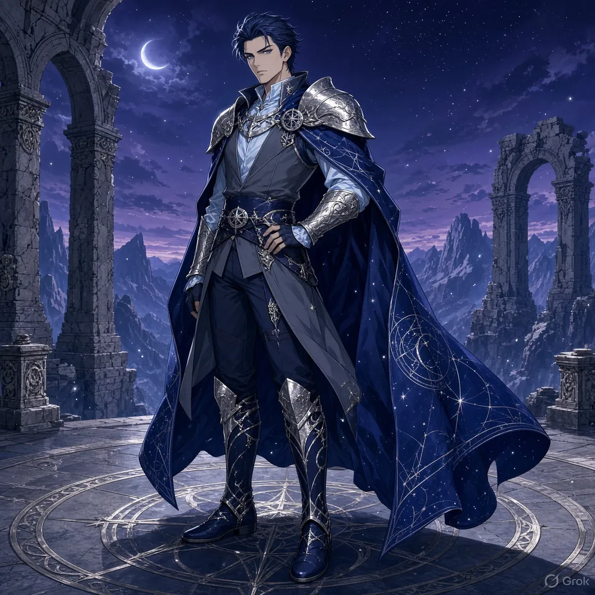

# The Astral Warden Cel-Shaded Concept Art — by @DavidLi36143625

[← Back to Community Examples](../../EXAMPLES.md) · Category: Illustration & 3D · Model: `Grok Imagine`

<a href="https://x.com/DavidLi36143625/status/2125518722869952620"></a>

Source: **[@DavidLi36143625 on X](https://x.com/DavidLi36143625/status/2125518722869952620)** · Creator: [David Liang](https://x.com/DavidLi36143625)

## Prompt

```text
Subject:
A poised male astral warden stands in a confident three-quarter heroic stance, neatly centered within a balanced 1:1 square composition with one shoulder angled forward and his hand resting lightly near his ornate belt. He wears a calm, resolute expression with sharp brows, piercing pale-blue eyes, and windswept dark-indigo hair swept back from a sculpted jawline. The entire figure is rendered in crisp cel-shaded concept art featuring clean ink linework, stylized anatomical clarity, and sharp, studio-polished shadow planes.

Attire:
His silhouette pairs a structured storm-slate wool surcoat and fitted charcoal-navy breeches over a luminous glacier-ice silk shirt with subtle pleated cuffs. Across his shoulders and forearms sit brushed silver pauldrons, a crescent gorget, and articulated vambraces engraved with intricate celestial filigree, anchored by a midnight-navy leather waist cincher. A sweeping asymmetrical mystic cloak of deep cobalt wool, lined in midnight navy satin and traced with cool pearl-thread star-chart embroidery, fastens at the collarbone with a brushed silver astrolabe clasp. Tall midnight-navy leather boots reinforced with brushed silver greaves complete the ensemble, with every metallic sheen and textile fold defined through crisp cel-shaded color blocking.

Scene:
He stands atop an ancient open-air celestial observatory terrace paved in pale slate stone inlaid with concentric silver meridian rings, framed by weathered stone arches and distant twilight peaks under a deep indigo sky. Cool directional moonlight from the upper left casts crisp, graphic two-tone shadows across the stone floor and highlights the brushed silver filigree against subtle drifting starlight motes. The environment maintains cohesive cel-shaded concept art discipline, pairing clean graphic foreground line weights with simplified, painterly atmospheric washes proportioned seamlessly for a 1:1 square frame.
```

## Try it

Paste the prompt into **[vinano.ai](https://vinano.ai?utm_source=github&utm_medium=readme&utm_campaign=awesome-image-video-prompts-updating&utm_content=x-page-try)** to generate your own version.

> The image and prompt belong to @DavidLi36143625 ([original post](https://x.com/DavidLi36143625/status/2125518722869952620)) and are shown here with credit for reference. Creators can ask for changes or removal by opening an issue.
