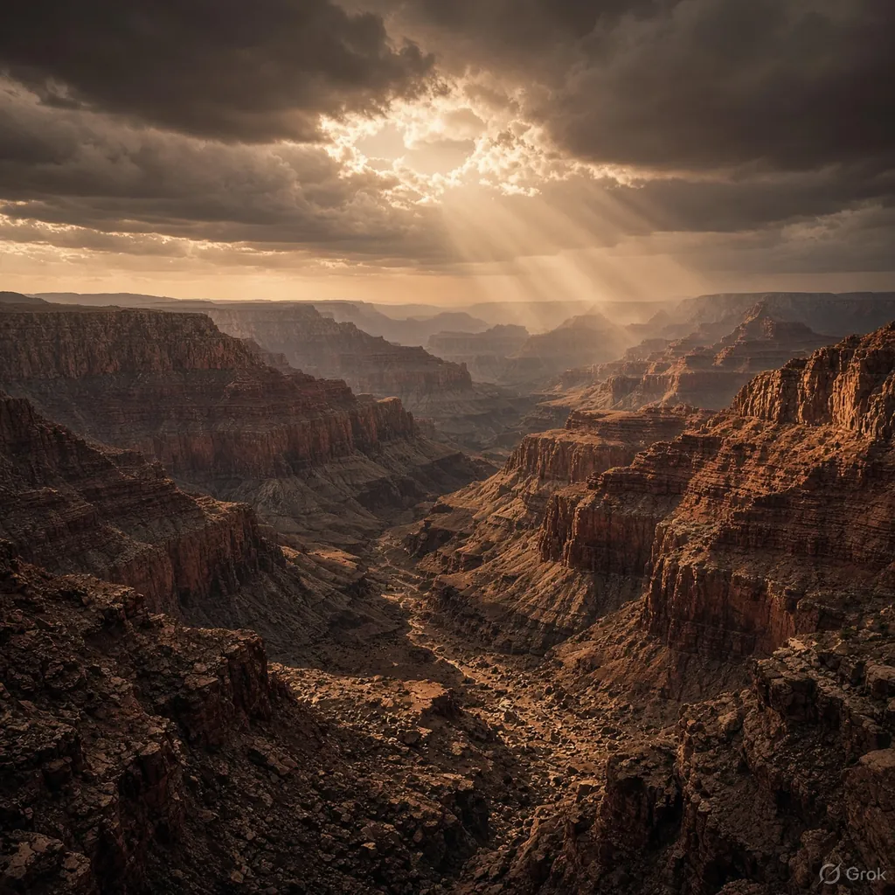

# Sienna Canyon Cloudbreak — by @DavidLi36143625

[← Back to Community Examples](../../EXAMPLES.md) · Category: Photography · Model: `Grok Imagine`

<a href="https://x.com/DavidLi36143625/status/2125471084028018987"></a>

Source: **[@DavidLi36143625 on X](https://x.com/DavidLi36143625/status/2125471084028018987)** · Creator: [David Liang](https://x.com/DavidLi36143625)

## Prompt

```text
A sweeping wide-angle cinematic photograph framed in a balanced 1:1 square composition, capturing the immense vastness of a pure, untouched rocky canyon in the afternoon. Layered sandstone cliffs and rugged weathered rock formations descend toward a distant stony gorge floor, stretching undisturbed to the horizon. Above, a dramatic cloudbreak parts heavy storm clouds, spilling warm amber shafts of sunlight across rich burnt sienna ridges and weathered stone neutrals. Deep cool umber shadows anchor the lower crevices, building layered atmospheric depth toward a soft apricot-diffused sky. Captured on a wide-field cinema lens with crisp geological textures, natural optical falloff, and subtle film grain.
```

## Try it

Paste the prompt into **[vinano.ai](https://vinano.ai?utm_source=github&utm_medium=readme&utm_campaign=awesome-image-video-prompts-updating&utm_content=x-page-try)** to generate your own version.

> The image and prompt belong to @DavidLi36143625 ([original post](https://x.com/DavidLi36143625/status/2125471084028018987)) and are shown here with credit for reference. Creators can ask for changes or removal by opening an issue.
