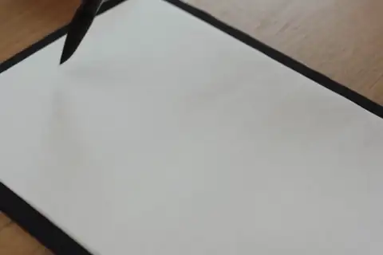

# Calligraphy Pen Writing Tokyo in Kanji — by @WR4NYGov

[← Back to Community Examples](../../EXAMPLES.md) · Category: Video · Model: `Grok Imagine`

<a href="https://x.com/WR4NYGov/status/2125708888519680258"></a>

**[▶ Watch the full video on X](https://x.com/WR4NYGov/status/2125708888519680258)** — the preview above is a short silent clip.

Source: **[@WR4NYGov on X](https://x.com/WR4NYGov/status/2125708888519680258)** · Creator: [Warren Redlich - Chasing Dreams 🇺🇸](https://x.com/WR4NYGov)

## Prompt

```text
A calligraphy pen writing the word 東京 on premium Japanese paper
```

## Try it

Paste the prompt into **[vinano.ai](https://vinano.ai?utm_source=github&utm_medium=readme&utm_campaign=awesome-image-video-prompts-updating&utm_content=x-page-try)** to generate your own version.

> The video and prompt belong to @WR4NYGov ([original post](https://x.com/WR4NYGov/status/2125708888519680258)) and are shown here with credit for reference. Creators can ask for changes or removal by opening an issue.
