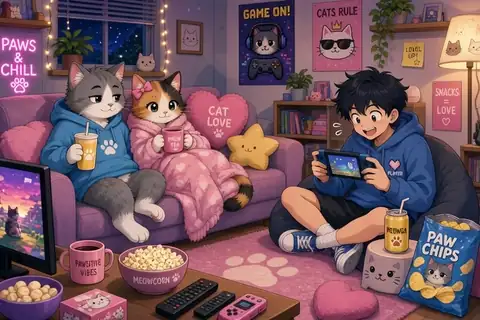

# Anime Cats Watching TV on the Sofa — by @victoroh919

[← Back to Community Examples](../../EXAMPLES.md) · Category: Video · Model: `Grok Imagine`

<a href="https://x.com/victoroh919/status/2125734903748903137"></a>

**[▶ Watch the full video on X](https://x.com/victoroh919/status/2125734903748903137)** — the preview above is a short silent clip.

Source: **[@victoroh919 on X](https://x.com/victoroh919/status/2125734903748903137)** · Creator: [Vict0r 0h 🤖](https://x.com/victoroh919)

## Prompt

```text
Create a cute anime image of a cat and his girlfriend chilling on the sofas watching TV while their owner boy plays video games on his handheld device, cute, funny, fun and colorful
```

## Try it

Paste the prompt into **[vinano.ai](https://vinano.ai?utm_source=github&utm_medium=readme&utm_campaign=awesome-image-video-prompts-updating&utm_content=x-page-try)** to generate your own version.

> The video and prompt belong to @victoroh919 ([original post](https://x.com/victoroh919/status/2125734903748903137)) and are shown here with credit for reference. Creators can ask for changes or removal by opening an issue.
