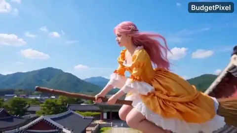

# Broomstick Flight Over Korean Landscapes — by @Rosey_watson

[← Back to Community Examples](../../EXAMPLES.md) · Category: Video · Model: `Wan 3.0`

<a href="https://x.com/Rosey_watson/status/2125577915182301537"></a>

**[▶ Watch the full video on X](https://x.com/Rosey_watson/status/2125577915182301537)** — the preview above is a short silent clip.

Source: **[@Rosey_watson on X](https://x.com/Rosey_watson/status/2125577915182301537)** · Creator: [Rosey Watson](https://x.com/Rosey_watson)

## Prompt

```text
A beautiful young woman with long, straight pastel-pink hair, wearing a vibrant yellow-orange princess dress with puffed sleeves, white lace ruffles, and a short layered skirt, flies on a magical wooden broomstick through breathtaking Korean landscapes.

0–5s | Magical Takeoff:
The video opens with an exciting low-angle tracking shot as the woman speeds across the stone courtyard of a magnificent traditional Korean royal palace. Her broomstick suddenly lifts into the air, her pink hair and flowing dress fluttering in the wind. The camera rapidly follows her upward.
5–10s | Rooftop Flight:
She soars above ancient Korean palace rooftops, gracefully maneuvering between traditional buildings. Dynamic drone-style tracking shots follow her from behind and alongside. Cut to a stunning close-up of her face against the clear blue sky, her expression calm and confident.
10–15s | Mountain Adventure:
The camera pulls dramatically backward to reveal enormous rocky mountains covered in lush green forests. She flies effortlessly between towering mountain peaks, passing dangerously close to dramatic cliffs. Sweeping aerial cinematography emphasizes the breathtaking scale.

15–22s | Magical Lake Flight:
She emerges above a vast, crystal-clear emerald lake surrounded by majestic mountains. Flying just inches above the water, her broomstick creates delicate ripples across the surface. Her reflection moves naturally beneath her as the camera tracks alongside.
22–30s | Epic Cinematic Finale:
She accelerates across the enormous lake toward distant mountains. The camera transitions into an extreme-wide aerial shot, slowly pulling farther away as she becomes a tiny figure against the spectacular landscape. Her silhouette and reflection remain visible on the peaceful water. End with a breathtaking panoramic view of the mountains and lake.
Visual Style: Photorealistic live-action fantasy, natural daylight, realistic wind physics, flowing fabric, detailed skin texture, cinematic drone movements, seamless transitions, realistic environmental reflections, expansive landscapes, and spectacular aerial cinematography.

Character Consistency: Maintain exactly the same face, pastel-pink hairstyle, yellow-orange princess dress, body proportions, and wooden broomstick throughout every shot.
Negative Prompt: Cartoon, anime, artificial CGI appearance, face morphing, outfit changes, distorted anatomy, unnatural flying movements, floating without broomstick, inconsistent scale, blurry landscapes, excessive magical particles, text, subtitles, watermarks.
```

## Try it

Paste the prompt into **[vinano.ai](https://vinano.ai?utm_source=github&utm_medium=readme&utm_campaign=awesome-image-video-prompts-updating&utm_content=x-page-try)** to generate your own version.

> The video and prompt belong to @Rosey_watson ([original post](https://x.com/Rosey_watson/status/2125577915182301537)) and are shown here with credit for reference. Creators can ask for changes or removal by opening an issue.
